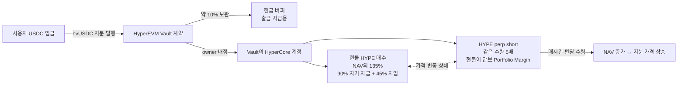

# HyperVault 사용자 가이드: 포지션 구축·수익·위험

2026-10-12 작성. 사용자에게 보여 주는 설명의 원본이다. FE의 제품 화면(홈·Vaults·Vault 상세)과 `#/docs`(Learn), Vault 화면의 "How the position is built" 도식이 같은 내용을 영어로 보여 준다. 기술 구조는 [구조 문서](hypervault-architecture.md), 운영 갭과 근거 데이터는 [운영 갭 분석](hypervault-operations-gap.md)을 따른다. 아래 시장 수치는 날짜를 붙인 관측값이며 수익 약속이 아니다.

## 1. 한 줄 요약

USDC를 넣으면 hvUSDC 지분을 받는다. Vault는 자기 HyperCore 계정에서 HYPE 현물을 사고 같은 양의 HYPE perp를 short해, 가격 변동은 상쇄하면서 perp long이 short에게 내는 **펀딩**을 번다. 가치(NAV)는 HyperCore 값을 온체인으로 읽어 계산한다.

## 2. 포지션이 만들어지는 과정

| 단계 | 누가 | 무엇을 | 확인 위치 |
| --- | --- | --- | --- |
| 1. 입금 | 사용자 | USDC 입금 → 그 시점 지분 가격으로 hvUSDC 발행 | Vault 화면 "Your position" |
| 2. 배정 | owner | 버퍼(목표 NAV의 10% 이상)를 남기고 나머지를 Vault의 Core 계정으로 보냄 | 화면 "Target split vs now" |
| 3. 헤지 구축 | API wallet | 현물 HYPE 매수 → **체결된 수량만큼** perp short | "Positions", "Activity" |
| 4. 운용 | 시장 | 매시간 펀딩 정산. short가 받으면 NAV 증가 | "Activity → Funding" |
| 5. 출금 | 사용자 → owner | 요청 → (Active면) owner가 청산·회수·정산 → claim | "Withdrawals" |

1,000 USDC 기준 목표 배분(Portfolio Margin 차입 루프, FE 추정치의 전제):

| 구성 | 금액 | 역할 |
| --- | ---: | --- |
| 현금 버퍼 (HyperEVM) | 100 | 출금 지급 |
| 현물 HYPE (Core) | 1,350 | long 다리이자 담보. 900은 자기 자금, 450은 차입 USDC로 매수 |
| HYPE perp short (5배) | (1,350 명목) | 헤지 다리, 펀딩 수령 |
| USDC 차입 | 720 | 추가 현물 450 + short 개시 증거금 270. PM이 자동 차입 |

PM에서는 주문에 잔액이 모자라면 담보(HYPE LTV 65%, BTC 50%)로 USDC를 자동 차입하고, perp 개시 증거금에도 이자가 붙는다(공식 문서 trading/portfolio-margin). 위 배분은 차입 한도의 약 82%를 쓴다. 차입 청산 기준은 담보 가치의 82.5%(0.5 + 0.5 × LTV)이고, 재조정하지 않으면 HYPE가 약 +167% 오를 때 도달한다(헤지 포지션은 하락 시 short 이익이 빚을 줄여 청산되지 않는다). 계산은 perp 유지 증거금과 20 USDC 최소 오프셋을 뺀 근사치다.

PM은 Core 계정 가치 $10k 이상에서만 쓸 수 있다. 그 아래(현재 상한 1,000 USDC 포함)에서는 short에 별도 USDC 증거금(2배면 300)이 필요해 현물 600·증거금 300·버퍼 100이 되고 펀딩을 버는 비중이 60%로 줄어든다.

HYPE가 10% 오르면 현물은 +135, short는 −135라 NAV는 거의 변하지 않는다. 헤지가 어긋난 금액(미헤지 노출)은 화면에 표시되고 2달러를 넘으면 경보가 울린다.

HYPE/BTC Vault(계획, 미배포)는 다르다. 입금한 HYPE/BTC가 PM 담보가 되고 USDC를 빌려 **추가분만** 현물 매수 + 같은 양 short 한다. 원래 자산 노출은 유지되고, 추가분이 "펀딩 − 차입 금리 − 증거금 이자"를 번다. 목표: HYPE는 NAV의 70% 추가(차입 84%, 한도 사용 76%, HYPE −80%에서 차입 청산), BTC는 50% 추가(차입 60%, 한도 사용 80%, BTC −84%에서 청산). 이 경우 가격 **하락**이 청산 방향이다.

## 3. 수익원 (2026-10-12 관측)

| 수익원 | 관측값 | 음수 가능 |
| --- | --- | --- |
| HYPE 펀딩 (주 수익원) | 90일 평균 10.05%, 30일 9.61%, 최악 7일 4.33% (연환산) | 예. 90일 중 약 9% 시간 음수, 최저 시간 −39.8% |
| USDC 대출 공급 | 3.49% (이용률 77.5%) | 아니오. 수요 감소 시 하락 |
| 차입 스프레드 (HYPE/BTC) | 펀딩 10.05% − 차입 5.00% | 예. 펀딩 < 차입 금리면 |

1,000 USDC 예시(PM 루프, 1,350 헤지·720 차입, 차입 금리 5%). 연 1회 진입·청산하고 기본 수수료(현물 0.07%, perp 0.045%)와 성과 수수료 10%를 반영했다. 계산 코드는 `frontend/src/yieldModel.ts`이다.

| 펀딩 | 펀딩 수입 | 차입 이자 | 거래 비용 | 성과 수수료 | 순수익 | 순 APR |
| --- | ---: | ---: | ---: | ---: | ---: | ---: |
| 90일 평균 10.05% | 135.68 | −36.00 | −3.10 | −9.66 | 86.91 | 8.69% |
| 30일 평균 9.61% | 129.74 | −36.00 | −3.10 | −9.06 | 81.57 | 8.16% |
| 최악 7일 4.33% | 58.45 | −36.00 | −3.10 | −1.93 | 17.41 | 1.74% |
| 0% | 0 | −36.00 | −3.10 | 0 | −39.11 | −3.91% |
| −10% | −135.00 | −36.00 | −3.10 | 0 | −174.11 | −17.41% |

차입 루프는 펀딩이 차입 비용(5% + 증거금 이자)보다 높을 때만 이익을 늘리고, 펀딩이 낮거나 음수면 손실을 키운다. 차입 금리는 이용률 80%까지 5%, 그 위로는 초과분의 4.75배가 더해진다(85%면 28.75%). 비교: 차입 없이 PM 1배 헤지면 7.14%, PM이 아니면(60% 헤지) 5.30%. PM은 Core 계정 $10k 이상에서만 켤 수 있다.

## 4. 수수료

- **성과 수수료:** 지분 가격이 이전 최고점(high-water mark)을 넘은 상승분의 10%를 새 지분으로 받는다. owner가 80%, 플랫폼이 20%를 가져간다. 손실을 회복하는 구간에서는 수수료가 없다. 짧은 급등에는 과금하지 않는다(최근 기록 중 최저 가격 기준).
- **관리·입금·출금 수수료:** 없다.
- **NAV에 이미 반영된 비용:** 거래 수수료, 차입 이자, Core 전송 gas.

## 5. 출금

| Vault 상태 | 요청 결과 | 받는 시점 |
| --- | --- | --- |
| Idle (전액 현금) | 같은 거래에서 현금 가격으로 정산 | 즉시 |
| Active (운용 중) | 현재 회차에 대기 → owner가 전체 청산·회수·정산 | 정산 뒤. 운영 약속은 요청 후 72시간 이내이고 monitor가 24시간에 경고, 72시간에 경보를 낸다 |
| 정산 중 | 다음 회차로 대기 | 현재 회차 정산 뒤 |

같은 회차의 모든 지분은 같은 가격을 받는다. 운용 중 정산을 사용자가 강제할 수는 없다. 대신 지분은 양도할 수 있다.

## 6. 위험과 대응

| 위험 | 생길 수 있는 일 | 대응 | 남는 위험 |
| --- | --- | --- | --- |
| 음수 펀딩 | short가 펀딩을 냄 | 24시간·7일 평균 감시 → 확대 중단 또는 헤지 해제 | 음수 기간 손실, 재진입 비용 |
| short 청산 | HYPE 급등으로 증거금 소진 | PM에서 현물 HYPE가 담보, 차입 한도 약 80%까지만 사용, 증거금 사용률 50%/80% 경보 | 급격한 가격 갭 |
| 차입 청산 | USDC Vault는 HYPE 급등, HYPE/BTC Vault는 급락 시 부분 청산(HYPE 82.5%, BTC 75%) | health 경보(청산선의 70%/85%) | 급락 |
| 차입 금리 급등 | 스프레드 역전 | 차입 APR 경보 | 일시적 손실 |
| 체결 | 두 다리 가격 차이, $10 최소 주문 | 체결 수량만큼 short | 슬리피지·잔량 |
| owner 신뢰 | 평가 범위 선택·자유 거래 | 범위 밖 보유 감시, 온체인 공개 | 제3자 검증 없음 (ADR-038) |
| 출금 지연 | 운용 중 owner 의존 | 72시간 약속·경보·버퍼 | 강제 출금 수단 없음 |
| 계약 | 버그로 손실·잠김 | 시험, 공개 코드, 48시간 업그레이드 지연 | 감사 없음 |
| Hyperliquid 플랫폼 | validator·오라클 사고, USDC 브리지 | HYPE·USDC 시장만 사용 | Vault 밖의 사건 |

## 7. 화면 안내

- **Vault 화면** (`#/vaults/<주소>`)
  - 온체인 NAV, 지분 가격, HWM
  - 포지션 구축 도식과 목표 대비 현재 배분
  - 실시간 포지션: 현물, perp, 대출과 health
  - 시장 금리(Vault 수익 아님), 실현 수익(30일 미만이면 연환산하지 않음)
  - 체결, 펀딩, 전송·대출 내역(탐색기 링크 포함)
- **Learn** (`#/docs`): 이 문서의 영문판.
- **Operations** (`#/ops`): 감시 규칙 15개의 현재 상태.
