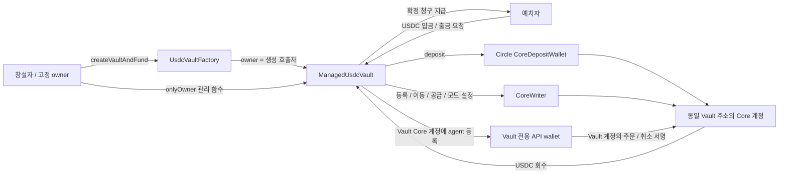

# 운용자 신뢰형 USDC Vault 아키텍처

상태: **로컬 구현·회귀 완료, 생산 Core 검증기와 실자금 시험 미완료**. 2026-10-04 [ADR-023](DECISIONS.ko.md#adr-023)·[ADR-025/026](DECISIONS.ko.md#adr-025)를 반영한다. 실제 ABI는 [Managed USDC 구현 명세](managed-usdc-vault-implementation.ko.md), 구현 상태는 [STATUS](STATUS.ko.md), 작업은 [BACKLOG](BACKLOG.ko.md)가 관리한다.

## 1. 상품과 신뢰 모델

누구나 Factory에서 Vault를 생성한다. Factory 호출자를 해당 Vault의 고정 `owner`이자 운용자로 설정하고 다른 사용자는 이 운용자를 신뢰해 USDC를 예치한다. 운용자는 API wallet으로 spot·기본 perp·HIP-3·HIP-4를 거래하고 손익·레버리지·담보 배치를 결정한다. API 직접 주문마다 EVM 계약의 시장·가격·노출 검사를 통과시키는 모델을 요구하지 않는다.

계약은 지분·원가·성과 수수료·출금 준비금과 자산 수령 경로를 관리한다. Core 자금은 같은 Vault EVM 주소로 회수하며 owner가 다른 수령자를 지정할 수 없다. 확정된 사용자 청구액은 새 운용에 투입하지 않는다. 운용자 신뢰를 이유로 share 가격을 임의로 지정하거나 Core 잔액을 이중 계상하지 않는다.

이 문서의 **BLP는 사용자가 언급한 Borrow/Lend 기능**을 뜻한다. 별도 외부 LP 상품을 뜻하지 않는다. CoreWriter action 15가 제공하는 동작은 `Supply`와 `Withdraw`다.

## 2. 계약과 주소

| 구성 | 책임 |
| --- | --- |
| `UsdcVaultFactory` | 고정 템플릿 배포, 창설자 지정, 초기 자금 이체 연결, Vault 등록/생성 이벤트 |
| `ManagedUsdcVault` | ERC-4626 동기 입금, ERC-7540 출금 요청·정산·claim, owner 관리 함수, Core 계정 소유 |
| `VaultCoreControl` | Vault가 상속하는 코드 모듈. typed Core 액션·권한·pending을 처리하며 독립 자산 보관 주소가 아님 |
| `CoreActions` | 내부 라이브러리로 action 인코딩. 실제 CoreWriter 호출은 Vault가 수행 |
| `VaultAccounting` / `VaultFees` | 내부 코드 모듈. 현금·인플라이트·준비금·원가·10% 성과 수수료/80:20 배분 |
| 화면·indexer | 로컬 API 키 생성, Core 주문/잔액 표시, 제출/실행 상태 추적. 자체 보고를 온체인 NAV 증명으로 사용하지 않음 |

`Vault EVM 주소 == Vault Core 주소 == CoreWriter caller`를 유지한다. 외부 모듈에 일반 `CALL`로 CoreWriter 실행을 맡기면 그 모듈의 Core 계정에서 실행되므로 금지한다. 기존 Vault 업그레이드 요청으로 OZ Transparent 프록시를 채택했다. proxy 주소를 Core 계정으로 유지하며 owner 제안·48시간 지연·Idle 실행과 storage 호환성 검사를 둔다. [현행 구현](managed-usdc-vault-implementation.ko.md)의 제약을 따른다.

## 3. 고정 owner와 권한

Factory는 직접 호출한 `msg.sender`를 새 Vault 생성자의 `owner_`로 전달한다. Vault의 `owner`는 변경 불가이며 Factory 주소로 초기화하지 않는다. 첫 버전은 `transferOwnership`·`renounceOwnership`을 노출하지 않는다. owner가 스마트 계정이면 그 계정이 Factory를 호출한다. 제3자를 owner로 지정하는 임의 파라미터나 `tx.origin`은 사용하지 않는다.

`onlyOwner`는 `msg.sender == owner` 검사다. 한 명뿐이므로 별도 EVM owner whitelist mapping은 필요 없다. **API wallet 주소는 Core 서명 권한만 받으며 Vault의 onlyOwner 권한은 받지 않는다.** ERC-7540의 `operator`는 예치자 요청/claim 대리 권한으로, Vault 운용자 권한과 별개다.

초기 자금 인식·창설자 mint용 초기화 진입점은 `onlyFactory`와 1회 실행 조건으로 제한하고 Factory 생성 거래 안에서 끝낸다. 외부 caller가 먼저 초기화하거나 생성 후 Factory가 다시 mint하는 경로는 없다.

Factory는 기존 Vault에 관리 권한을 가지지 않는다. asset, Circle 계약, CoreWriter, 네트워크 토큰 정보, 생성 시 선택한 성과 수수료율(기본 10%), 플랫폼 배분율 20%, treasury 및 builder 정책은 배포 시 확정한 설정을 따른다. owner 개인 자산과 Vault 자산을 섞어 보내는 관리 함수를 만들지 않는다.

## 4. 목표 함수와 권한

아래 이름은 구현할 인터페이스의 설계명이다. Core 액션 함수는 제출 식별자를 반환하고, 반환 성공을 Core 실행 완료라고 표시하지 않는다.

| 위치 / 함수 | 권한 | 동작·고정 조건 |
| --- | --- | --- |
| Factory `createVaultAndFund(config, maxActivationCost)` | 누구나 | 호출자를 owner·초기 지분 수령자로 고정. USDC 원금 100과 별도 활성화 비용 조달, 원금만 지분 발행, 같은 EVM 거래에서 초기 Core 배정 |
| Vault `setApiWallet(agent)` | onlyOwner | action 9. 첫 버전은 고정된 하나의 agent 슬롯(빈 이름)을 등록/교체. 오프체인에서 생성한 공개 주소만 받음 |
| Vault `revokeApiWallet()` | onlyOwner | Core 등록을 실제 철회하는 제어 경로. 로컬 주소를 지우는 것으로 완료 처리하지 않음. 구체적 wire 표현은 아래 검증 조건 참조 |
| Vault `depositToCore(usdcAmount)` | onlyOwner | Circle `deposit`을 Vault가 호출. USDC·자기 Core·첫 구현의 spot 목적지 고정. 미예약 장부 현금만 배정 |
| Vault `recallUsdcFromCore(sourceDex, usdcAmount)` | onlyOwner | action 13. USDC system 주소를 경유해 같은 Vault EVM 주소로 회수. 외부 `receiver` 파라미터 없음 |
| Vault `transferWithinCore(token, sourceDex, destinationDex, coreAmount)` | onlyOwner | action 13. destination은 같은 Vault, subAccount는 0으로 고정. spot/DEX 사이 담보 재배치 |
| Vault `supplyToLending(token, coreAmount)` | onlyOwner | action 15 / Supply. token metadata·단위 검증. 0 수량은 거부 |
| Vault `withdrawFromLending(token, coreAmount)` | onlyOwner | action 15 / Withdraw. 0 수량은 거부 |
| Vault `withdrawAllFromLending(token)` | onlyOwner | action 15 / Withdraw의 0=MAX를 명시적으로 선택하는 별도 함수 |
| Vault `setAbstraction(mode)` | onlyOwner | action 16. 대상 user는 `address(this)`. Disabled/Unified/PortfolioMargin만 허용 |
| Vault `approveBuilderFee(maxFeeRate)` | onlyOwner | action 12. 배포 설정의 builder 주소·상한 안에서 승인. 성과 수수료와 독립 |
| Vault `beginExit(epoch)` | onlyOwner | 신규 입금/재배정을 닫고 운용자가 주문 취소·포지션 종료·회수를 진행할 상태로 전환 |
| Vault `finalizeActivation()` / `syncCoreAction(actionId)` | 누구나 | 계약이 검증 가능한 Core 상태/수신 증거로 정해진 전이만 수행. 임의 잔액·성공 플래그를 받아 확정하지 않음 |
| Vault `deposit/mint` | 예치자 | 허용 입금 창의 검증된 가격으로 동기 share 발행 |
| Vault `requestRedeem` | share 보유자 / 승인 operator | ERC-7540 요청과 원가 고정. 이때 운용자에게 자금을 지급하지 않음 |
| Vault `settleEpoch(epoch)` | 누구나, 검증 조건 충족 시 | 실수령·정산 조건에서 요청별 권리·수수료와 준비금 고정. caller가 가격/이익을 정하지 않음 |
| Vault `redeem/withdraw` | controller / 승인 operator | 확정 claim 지급. 사용자 순수령과 운용자·플랫폼 fee 배분 |

USDC 이동 함수의 `usdcAmount`는 EVM 6자리 단위로 통일하고 Core 8자리 변환은 내부에서 수행한다. 일반 lending/계정 내 이동의 `coreAmount`는 토큰 metadata에 맞는 Core 단위이며, UI에서 검증된 decimals로 변환한다. unsigned ABI 폭·overflow·0=MAX를 명확히 구분한다.

`Borrow lend operation` 및 `Set abstraction`은 **외부에서 owner가 호출할 수 있는 `external onlyOwner` 함수**로 만들어야 한다. 함수 본문에서 Vault가 CoreWriter를 호출한다. Solidity `internal` 함수만 만들면 owner 지갑에서 호출할 수 없다. 내부 `_submit...` 구현을 공유하는 것은 가능하다.

기본 주문·취소는 API wallet 경로를 사용한다. HIP-4 split/merge 등의 추가 기능은 지원 API와 action 17에 맞춘 typed 확장으로 연결하며 기본 주문 지원과 혼동하지 않는다. 첫 관리 인터페이스에는 임의 payload `execute(bytes)`·임의 target `call`·임의 USDC 수령자를 받는 함수를 두지 않는다.

## 5. API wallet 생성·등록·교체

**등록 주체와 계정 귀속은 Vault다.** Vault별 전용 API wallet을 그 Vault Core 계정의 agent로 등록한다. owner는 Vault의 등록·교체 함수를 호출하고 전용 키를 보관·사용하는 운용자다. owner 개인 Core 계정의 API wallet을 등록하는 흐름으로 설명하지 않는다.

| 주소 | 역할 |
| --- | --- |
| `owner` | Vault의 EVM 관리 함수를 호출하는 창설자 |
| `address(vault)` | Core master 계정·자산·포지션·손익 귀속 주소 |
| `vaultApiWallet` | 그 Vault Core 계정에 등록된 전용 서명자 |

1. 운용자가 장치/서명 서비스에서 해당 Vault 전용 API 키를 만든다. 개인키는 Vault·Factory·이벤트·프로젝트 문서로 보내지 않는다.
2. Core 활성화가 확인된 후 owner가 Vault의 `setApiWallet(agentAddress)`를 호출한다.
3. Vault가 자기 주소로 CoreWriter action 9를 제출한다. 빈 이름의 단일 슬롯을 써 새 키 등록이 같은 슬롯의 기존 키를 교체하도록 한다.
4. Core 등록 적용을 확인한 후 Vault 전용 agent로 Vault 자산을 거래한다. 정보 조회의 account는 agent 주소가 아닌 Vault 주소다. `vaultAddress`를 Hyperliquid 기본 Vault의 라우팅과 혼동하지 않는다.
5. 교체할 때는 새 키를 만들고 같은 슬롯을 교체한다. 폐기한 agent 주소는 재사용하지 않는다.

공식 문서는 같은 슬롯 등록에 따른 기존 키 해지와 만료를 설명한다. 별도 CoreWriter revoke action이나 `address(0)` 승인 수용은 여기서 확정하지 않는다. `revokeApiWallet()`은 Vault별 hash-derived 비서명 주소로 같은 unnamed 슬롯을 교체하는 코드를 구현했다. 실제 Core 해지 효과는 통제 실험으로 검증해야 한다. 첫 구현의 기본 교체 수단은 검증 가능한 같은 슬롯 재등록이다. 기존 미체결 주문·이미 접수된 주문은 키 해지와 별도로 취소·처리 확인이 필요하다.

`setApiWallet` 등록·교체 완료나 철회 여부는 action별 근거로 추적한다. EVM 저장값이나 일반 잔액 precompile만으로 Core agent 등록 상태를 증명할 수 있다고 가정하지 않는다. 확인 수단이 UI/API 조회뿐이면 그 신뢰 범위를 표시하고 자동 회계 확정 근거로 쓰지 않는다.

## 6. 생성과 운용 순서

1. **생성:** 창설자가 Factory에 USDC를 승인하고 `createVaultAndFund`를 실행한다. 새 Vault의 owner는 창설자로 고정된다. 원금 100은 창설자 share 100을 만들고 활성화 비용은 별도로 처리한다. 사용자 희망 예산은 101 USDC이며 실제 Circle 설정의 비용 차감 위치는 네트워크 profile에 맞춰 검증한다.
2. **활성화:** Vault가 Circle `deposit`으로 자기 Core에 보낸다. 다음 처리 단계 이후 `finalizeActivation`으로 Core 준비 상태를 확인한다. share는 재발행하지 않는다.
3. **설정:** owner가 원하는 계정 모드를 action 16으로 선택하고 API wallet을 action 9로 등록한다. builder fee가 필요하면 action 12를 승인한다. 생성과 같은 EVM 블록에서 CoreWriter까지 처리된다고 가정하지 않는다. UI는 필요한 설정을 안내하되 의존 액션의 Core 완료를 기다린다.
4. **운용:** owner가 관리 함수로 USDC 배정·lending 공급/회수·계정 내 이동을 실행하고 API wallet으로 시장 주문을 보낸다. EVM 관리 거래의 HYPE 가스는 그 거래 제출자가 부담한다.
5. **출금:** 사용자는 ERC-7540 요청을 남긴다. owner가 운용을 정리해 같은 Vault EVM 주소로 USDC를 회수한다. 검증된 정산이 요청별 준비금을 잠그면 사용자 또는 승인 operator가 claim한다.

일반 사용자 동기 입금은 실현 현금의 Idle 경로와 [ADR-027](DECISIONS.ko.md#adr-027)의 검증된 Ready/Active NAV 경로를 제공한다. Active gate와 운용자 등록 범위의 precompile 평가기·검증기는 로컬 구현했지만([ADR-029](DECISIONS.ko.md#adr-029)), 통제 왕복으로 검증하지 않아 실자금 상시 입금 개방은 아직 미완료다. [구현 경계](managed-precompile-nav.ko.md) 운용자가 거래할 수 있다는 신뢰와 신규 지분의 공정한 가격은 별개이므로, API 거래가 계속되는 동안 고정 원금 가격으로 mint하지 않는다. 입금 창·정산 중 agent와 열린 주문/인플라이트에 의한 상태 변경을 어떻게 배제/검증하는지는 MARKET-002와 NAV-001의 구현 조건이다.

## 7. 출금과 회계의 책임

owner의 Core→EVM 회수는 **Vault 운용 자금을 Vault로 되돌리는 동작**이다. 사용자에게 지급하는 ERC-7540 `withdraw/redeem`과 별도다. owner는 `recallUsdcFromCore`에 자신의 개인 주소를 넣을 수 없으며, owner 자신의 지분 출금도 일반 요청/claim 경로를 따른다.

운용자와 예치자의 성과 수수료 관계는 기존 [수수료 명세](performance-fee-architecture.ko.md)를 유지한다. 다른 사용자의 출금 이익에 생성 시 선택한 요율(기본 10%)을 적용하고 그 수수료의 80%를 owner, 20%를 플랫폼에 지급한다. 이미 확정된 총 claim 준비금은 owner의 `depositToCore` 배정에서 제외한다. 비요청 직접 송금, 인플라이트, Core 잔액, 실제 EVM 회수액을 중복 인식하지 않는다.

이번 owner 모델에서 포지션 종료·Core 회수는 owner가 수행한다. 예치자의 **요청 제출**과 **이미 확정된 청구액 지급**은 owner의 추가 승인을 요구하지 않는다. owner의 협조 없이 모든 시장 포지션을 강제 종료해 출금을 완료하는 기능은 첫 구조에 포함하지 않는다. 이전 WHYPE의 자동 keeper/permissionless 전략 회수 보장을 이 수동 운용 상품에 그대로 적용하지 않는다.

CoreWriter action별 pending은 제출된 payload와 전후 관측을 추적하는 관리 액션 원장이다. 모든 API 주문이 여기에 직렬 등록된다고 가정하지 않는다. API 직접 거래와 겹쳐 결과를 구분할 수 없으면 관리 액션/회계를 미확인 상태로 유지한다. keeper는 고정 조건의 확인·정산을 실행할 수 있지만 owner 지갑을 대신해 임의 관리 명령을 내리지 않는다.

## 8. 구현 단위와 근거

구현은 Factory/immutable owner → Vault 관리 함수와 Core 인코딩 → agent 서명 연결 → 자산 왕복/출금 회계 → 성과 수수료/시장별 상태 확인 순서로 진행한다. Solidity 함수가 제출하는 action의 mock 검증, 계약 계정의 실제 메인넷 등록/주문/이동 검증, 전체 시장 NAV/출금 검증을 구분한다. owner가 고정돼도 Core 계정의 외부 프로토콜 동작이 검증된 것은 아니다.

| 근거 | 이 설계에서 확인하는 사실 |
| --- | --- |
| [Hyperliquid CoreWriter](https://hyperliquid.gitbook.io/hyperliquid-docs/for-developers/hyperevm/interacting-with-hypercore) | action 9/12/13/15/16/17 형식과 호출 계약 계정 귀속 |
| [API wallets](https://hyperliquid.gitbook.io/hyperliquid-docs/for-developers/api/nonces-and-api-wallets) | agent는 서명용, 같은 슬롯 교체, 키 주소 재사용 주의 |
| [Exchange API](https://hyperliquid.gitbook.io/hyperliquid-docs/for-developers/api/exchange-endpoint) | agent 주문·동일 주소 전송·agentSetAbstraction |
| [Circle Core→EVM](https://developers.circle.com/cctp/howtos/withdraw-usdc-from-hypercore-to-hyperevm) | 같은 EVM 주소로 USDC 출금, system destination; 계약 CoreWriter 왕복은 별도 통제 검증 |
| [Hyperliquid 처리 순서](https://hyperliquid.gitbook.io/hyperliquid-docs/for-developers/hyperevm/interaction-timings) | 신규 계정 생성과 후속 CoreWriter 제출의 블록 경계 |

실제 action 9 등록/철회, action 13 USDC 회수, action 15/16 공급·모드 전환 확인은 [MARKET-002](BACKLOG.ko.md#market-002)와 [USDC-001](BACKLOG.ko.md#usdc-001)에 연결한다. 위 개념 함수명과 실제 ABI의 차이는 [현행 명세](managed-usdc-vault-implementation.ko.md)를 따른다. 실제 메인넷 실행 완료로 표시하지 않는다.
