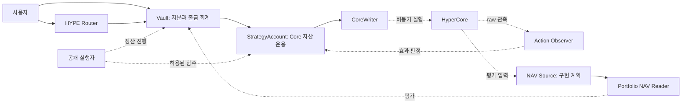

# 다음 구현을 위한 기획 패키지

작성: 2026-09-21 KST. **구현 전 제안서**다. 채택된 결정은 [DECISIONS](../DECISIONS.ko.md), 현재 코드 상태는 [STATUS](../STATUS.ko.md), 작업 진행은 [BACKLOG](../BACKLOG.ko.md)가 관리한다. 이 패키지를 작성했다는 이유로 기능이나 외부 동작을 구현·검증 완료로 바꾸지 않는다.

Vault 프로젝트 전체의 현재 아키텍처 경계와 배포 단계는 [Vault 아키텍처 기준선](../vault-architecture.ko.md)에 연결한다. 이 기획 패키지의 `PROPOSED`/`CONDITIONAL` 동작은 해당 기준선에 언급돼도 구현된 ABI나 검증된 네트워크 동작으로 승격되지 않는다.

## 범위와 읽는 순서

현재 프로젝트에서 자료만으로 설계할 수 있는 제품·컨트랙트·운영·화면·시험·배포 요구사항을 다룬다. 네트워크에서 확인해야 하는 값과 사업상 선택이 필요한 정책은 아래 열린 결정으로 남긴다. 계획의 세부안은 `PROPOSED`, 관측에 따라 달라지는 안은 `CONDITIONAL`이며 기존 ACCEPTED 결정을 묵시적으로 대체하지 않는다.

| 기획서 | 다루는 내용 | 연결 작업 |
| --- | --- | --- |
| [01 상품 요구사항](product.ko.md) | 상품 단계, 사용자 여정, 성과 표시, 범위 | PROD-001 |
| [02 PM·bridge·운용 생명주기](core-lifecycle.ko.md) | 자동 공급 분기, 초기화, 전량 회수, 상태 불변조건 | CORE-001, ENV-001 |
| [03 액션 복구](action-recovery.ko.md) | finality 신뢰 모델, 중복 방지, recall 순수령액 | CORE-002, CORE-003 |
| [04 생산용 NAV source](nav-source.ko.md) | 관측 범위, 필드 매핑, 단위, 시점, 완전성 | NAV-001 |
| [05 회계·수수료·잔여 자산](accounting-fees.ko.md) | 소유권 원장, 비용, gas, dust, 손실 | CORE-004, CORE-005 |
| [06 Active 입금](active-deposits.ko.md) | 공정 발행, preview/max, 조작·희석 방지 | VAULT-001 |
| [07 출금 buffer·부분 회수](liquidity-exits.ko.md) | epoch 처리, 동일 가격, 부분 전략 종료 | LIQ-001 |
| [08 위험·파라미터](risk-parameters.ko.md) | 위험 신호, 제한, 설정 단위와 보정 방법 | CORE-006, RISK-001 |
| [09 keeper·indexer](keeper-indexer.ko.md) | 실행 스케줄, 멱등성, reorg, 관측 데이터 | OPS-001 |
| [10 사용자 화면·통합 API](frontend.ko.md) | 상태 표시, 입금·request·claim, 승인, 오류 | UX-001 |
| [11 보안·표준 검토](security-standards.ko.md) | 위협 모델, 권한, 표준 대조, 감사 범위 | STD-001, SEC-001 |
| [12 테스트·실측](validation.ko.md) | 요구사항별 시험, 통제된 전후 원장, 실패 실험 | QA-001, ENV-001 |
| [13 배포·운영 인계](release-operations.ko.md) | manifest, 준비 단계, 장애 대응, 새 버전 이전 | REL-001 |
| [14 외부 프로토콜 확장](multistrategy.ko.md) | 외부 custody adapter, 배분, 독립 회수; Core 시장 범위와 분리 | STRAT-001 |
| [외부 근거와 가정](sources.ko.md) | 재확인한 공식 문서, 모순·확인 한계 | 모든 외부 의존 작업 |

실행 기록 형식도 포함한다: [배포 manifest](templates/deployment-manifest.example.json), [실험 기록](templates/experiment-record.example.json), [파라미터 profile](templates/parameter-profile.example.json). 모두 미실행·미배포 예시이며 비밀이나 운영 기본값은 없다.

## 구성과 개발 단위

| 개발 단위 | 변경 경계 | 검증 후 다음 단계 |
| --- | --- | --- |
| PM 초기화·공급 | Strategy·Observer·RiskOracle·실험 fixture | 실제 계정 상태 전이와 전량 왕복 |
| 복구·귀속 | pending/receipt·receive/wrap·반환 검증 | 중복 실행·순수령·gas/dust 원장 |
| 생산용 평가 | source·metadata/단위·가격·reader scope | 원장 대조·누락/중복·시점 검증 |
| Active 입금 | Vault pricing/max/preview·Router·위험 cap | 기존/신규 지분 공정성·bytecode 크기 |
| 부분 회수 | liquidity intent·epoch·잔존 NAV/위험 | 동일 환율·실제 현금 예약·full-exit fallback |
| 서비스와 UI | read collector→dry-run→keeper→화면 | reorg·경쟁·권한·사용자 왕복 |

한 변경에서 서로 다른 신뢰 모델이나 상품 기준 자산을 함께 바꾸지 않는 편으로 작업을 나눈다. 실제 착수 순서와 상태는 BACKLOG를 따른다.

## 요구사항 추적

요구사항 ID는 고정한다. 상세 동작은 연결 기획서, 시험 절차는 validation의 동일 ID가 관리한다. 기존 테스트가 있어도 확장 기능의 테스트 완료로 해석하지 않는다.

| ID | 충족해야 하는 결과 | 설계 원본 |
| --- | --- | --- |
| REQ-01 | 기준 자산과 손익 표시 통화가 분명함 | [상품](product.ko.md) |
| REQ-02 | Vault 회계와 Core 실행 주체가 분리됨 | [생명주기](core-lifecycle.ko.md) |
| REQ-03 | PM 적용·bridge·공급을 구분하고 중복 투입하지 않음 | [생명주기](core-lifecycle.ko.md) |
| REQ-04 | 미확정 액션을 재시도해 노출을 중복 생성하지 않음 | [복구](action-recovery.ko.md) |
| REQ-05 | 순수령액을 한 번만 귀속하고 실제 반환액으로 정산 | [복구](action-recovery.ko.md) |
| REQ-06 | 모든 허용 경제 자산·부채를 한 번만 NAV에 반영 | [NAV](nav-source.ko.md) |
| REQ-07 | read 실패·불완전·오래된 가격으로 거래하지 않음 | [NAV](nav-source.ko.md) |
| REQ-08 | 신규 입금이 과거 손익·비용을 부당 이전하지 않음 | [입금](active-deposits.ko.md) |
| REQ-09 | 동일 epoch가 같은 가격과 처리 비율을 적용받음 | [유동성](liquidity-exits.ko.md) |
| REQ-10 | 확정 claim 준비금이 투자·recap·수수료와 격리됨 | [회계](accounting-fees.ko.md) |
| REQ-11 | gas·dust·후원·손실의 소유권이 cycle 사이에 섞이지 않음 | [회계](accounting-fees.ko.md) |
| REQ-12 | buffer 포함 전체 포지션 위험과 PM health를 제한 | [위험](risk-parameters.ko.md) |
| REQ-13 | 운영자 부재에도 허용된 회수·고정 수령을 진행 가능 | [운영](keeper-indexer.ko.md) |
| REQ-14 | 화면이 추정·미확정·확정 지급을 구분 | [화면](frontend.ko.md) |
| REQ-15 | 표준 ABI·권한·불변조건을 근거로 검토 | [보안·표준](security-standards.ko.md) |
| REQ-16 | 배포 산출물과 실제 주소·설정을 재현 가능 | [배포](release-operations.ko.md) |
| REQ-17 | 자산·전략 변경이 기존 지분의 의미를 바꾸지 않음 | [확장](multistrategy.ko.md) |
| REQ-18 | 계획·mock·실제 실험·배포 완료를 구별 | [시험](validation.ko.md) |

## 정책 결정 등록부

2026-09-21 최초 기획의 권장안은 구현 검토를 위한 출발점이었다. 2026-10-02 후속 USDC 입출금 방향을 [ADR-010](../DECISIONS.ko.md#adr-010)으로 채택했다. 나머지 OPEN 값은 미확정이며 값을 정하면 이 표에 결정 ID를 연결한다. 개인정보·비밀키는 여기에 기록하지 않는다.

| ID | 열려 있는 선택 | 이번 제안 | 해결 근거/담당 성격 |
| --- | --- | --- | --- |
| OPEN-01 | 후속 상품 기준 자산 | **RESOLVED:** HyperEVM USDC 입출금·USDC 지분의 새 배포 쌍; 현행 WHYPE 코드는 유지 | [ADR-010](../DECISIONS.ko.md#adr-010), [USDC-001](../BACKLOG.ko.md#usdc-001) |
| OPEN-02 | 관리·성과·입출금 수수료 | **USDC 상품 성과 수수료 해결:** 출금 이익 10% 중 플랫폼 20%·운용자 80%; 관리·입금·정액 출금 fee 없음; WHYPE 정책은 별개 | [ADR-016](../DECISIONS.ko.md#adr-016), [ADR-017](../DECISIONS.ko.md#adr-017), [FEE-001](../BACKLOG.ko.md#fee-001) |
| OPEN-03 | 후속 부분 회수용 USDC buffer 규모와 전체 시장 노출 | 첫 배포 후보의 목표 운용 buffer 0 가능은 ADR-012; 이후 buffer를 주주 현금으로 두고 spot·기본/HIP-3 perp·HIP-4의 잔존 위험을 함께 계산 | 빠른/부분 출금을 도입할 때의 buffer 규모와 시장별 위험 모델; 기존 WHYPE 초안은 현행 프로토타입 설명 |
| OPEN-04 | finality/PM 성공 증거 부족 시 신뢰 모델 | 현 모델 유지, 증거 없으면 대기; attested 복구는 별도 상품 변경 | 프로토콜 증거 또는 명시적 신뢰 결정 |
| OPEN-05 | gas·dust 비용 부담자 | 초기 gas는 후원·비상환; dust는 실제 환전/공정한 후원 매입 또는 대기 | 실측 비용·회계 정책 |
| OPEN-06 | 최소 입금·TVL·slippage·health·대기 상한 | 재현 실험으로 보정; 운영 수치 임의 확정 금지 | [파라미터 명세](risk-parameters.ko.md) |
| OPEN-07 | 테스트넷 환경과 출시 담당 역할 | 역할·주소·예산은 manifest에서 실제 값으로 확정 | ENV-001, REL-001 |
| OPEN-08 | 후기 성과 수수료의 HWM·평가 통화 | **USDC 상품 해결:** 실제 출금 USDC·사용자 원가·손실 이월 기준; WHYPE 후기 수수료는 별개 | [ADR-016](../DECISIONS.ko.md#adr-016), [상세 수식](../performance-fee-architecture.ko.md) |
| OPEN-09 | 창설자 최초 지분의 운용 중 출금 | **제안:** 활성 Vault에서는 생성 시 EVM USDC 100에 발행된 창설자 share를 유지하고, 추가 share는 인출 후 창설자 지분율이 5% 이상일 때 출금 허용. 신규 외부 입금도 창설자 지분율을 5% 미만으로 낮추면 거부하거나 cap으로 제한. Vault 종료·타 예치자 청구액 확정/준비금 확보 후 창설자 잔여 지분 전액 출금 허용. Core 자금 미도착 시 창설자 지분·자산 회수는 별도 | [ADR-021](../DECISIONS.ko.md#adr-021), [FACTORY-001](../BACKLOG.ko.md#factory-001), [Hyperliquid legacy leader 규칙](https://hyperliquid.gitbook.io/hyperliquid-docs/hypercore/vaults/for-vault-leaders-legacy) |

## 작성 완료와 개발 완료의 구분

이번 패키지는 검토 가능한 첫 설계본이다. 구현 순서는 BACKLOG를 따른다. 출시 값·네트워크 증거가 필요한 조건을 빈칸으로 감추지 않고 OPEN ID와 시험으로 연결했다. 외부 DEX·대출 프로토콜 선정, 실제 배포 주소, 투자 수익 보장, 법적 상품 분류는 현재 근거로 작성할 수 있는 확정 명세의 범위를 벗어난다.

통합 전 기획서의 제안 API·상태 enum·이벤트 이름은 실제 ABI가 아니다. 채택·구현 시 현행 명세에 옮기고 CHANGELOG에 호환성 영향을 남긴다.
