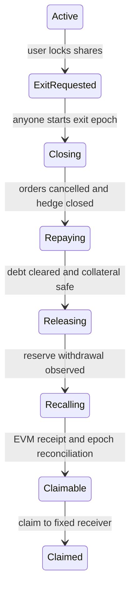

# HyperCore Earn / HYPE funding carry vault 조사

이력 문서다. 아래 구현·검증 수치는 당시 기준이며 최신 상태는 [STATUS](STATUS.ko.md), 현행 동작은 [분리 구현 명세](split-implementation.ko.md), 문서 우선순위는 [문서 안내](README.md)를 따른다.

조사일: 2026-09-18 KST, 구현 갱신일: 2026-09-19 KST. `earm`은 Earn / borrow-lend를 의미한다고 가정했다. 공식 문서, 공식 첨부 Solidity ABI, 양 네트워크의 공개 RPC를 확인했다. 이후 입금·share 회계·1x carry 전략·permissionless exit를 결합한 integration-gated MVP를 구현했다. 로컬 구현 완료와 실제 HyperCore write 검증은 구분한다.

## 1. 결론과 상품 선택

HyperEVM 컨트랙트가 자기 주소의 HyperCore 계정을 CoreWriter로 운용하는 구조는 가능하다. 첫 상품으로는 **HYPE 현물 보유 + 동일 수량 HYPE perp short + Portfolio Margin(PM)의 자동 USDC 차입**을 검토한다. USDC를 미리 정액 차입하는 별도 `borrow()` 호출을 가정하지 않는다. PM의 주문/손익 처리에서 필요한 차입이 발생한다. [공식 PM 문서](https://hyperliquid.gitbook.io/hyperliquid-docs/trading/portfolio-margin)

중요한 범위 제한: PM의 차입 가능 잔액은 내부 거래용이며 주소 간 전송이나 출금에 사용할 수 없다. 따라서 **Core에서 USDC를 빌려 EVM으로 보내는 전략은 지원된다고 설계하면 안 된다.** 외부 운용이 필요하면 EVM 대출 adapter가 별도로 필요하다. 입금과 실현이익을 통한 자동 상환, idle USDC의 자동 공급도 PM의 동작이다. [공식 PM FAQ](https://hyperliquid.gitbook.io/hyperliquid-docs/support/faq/portfolio-margin)

| 후보 | 구조 | 판단 |
|---|---|---|
| HYPE Core carry | HYPE 현물 + HYPE perp short, PM 자동 차입 | 요청과 가장 가까움. 첫 전략 후보 |
| USDC Earn vault | USDC 공급, 이자 회수 | 차입·헤지가 없어 연동 검증이 더 단순함. 별도 상품 |
| EVM 대출 + Core short | EVM 담보/USDC debt, Core에 증거금 이동 | 가능성은 별도 조사 필요. 두 청산 시스템과 브리지 대기 위험 추가 |
| HYPE 담보 + 다른 자산 carry | HYPE 유지, 빌린 USDC로 BTC 현물/short 등 | HYPE 가격 노출이 남음. 전체 vault를 delta neutral이라고 부르면 안 됨 |

HYPE 담보를 보유한다고 곧 HYPE lending yield가 생기는 것은 아니다. 조회한 HYPE reserve의 supply rate는 0이었다. funding carry와 USDC Earn은 회계와 위험이 다른 상품으로 구분한다.

## 2. 직접 확인한 네트워크 상태

2026-09-18 08:13:54 UTC에 읽기 전용 probe를 시작했다. EVM 조회는 네트워크별 아래 블록으로 고정했다. `spotMeta`/`meta` HTTP 조회는 동일 블록 보장이 없다. 원시 자료: [mainnet-probe.json](reference/mainnet-probe.json), [testnet-probe.json](reference/testnet-probe.json).

| 항목 | Mainnet | Testnet |
|---|---:|---:|
| Chain ID | 999 | 998 |
| EVM block | 46,220,582 | 64,584,210 |
| CoreWriter bytecode 크기 | 544 bytes | 544 bytes |
| canonical WHYPE bytecode 크기 | 2,041 bytes | 2,041 bytes |
| HYPE token index | 150 | 1105 |
| HYPE/USDC spot index | 107 | 1035 |
| HYPE/USDC spot order asset ID | 10107 | 11035 |
| HYPE perp asset ID | 159 | 135 |
| HYPE Core wei decimals | 8 | 8 |
| USDC Core wei decimals | 8 | 8 |
| USDC EVM extra decimals (metadata) | -2 | -2 |
| HYPE LTV | 6500 bps = 65% | 6500 bps = 65% |
| USDC borrow yearly rate | 500 bps | 500 bps |
| USDC supply yearly rate | 290 bps | 33 bps |
| HYPE supply yearly rate | 0 bps | 0 bps |
| HYPE perp mode | `onlyIsolated` 응답 필드 없음 | `onlyIsolated=true`, `strictIsolated` |

위 수치는 수익 예측이나 고정 운영 파라미터가 아니다. 특히 **테스트넷 HYPE perp는 PM의 cross-margin carry 재현 대상으로 사용할 수 있는지 먼저 확인해야 한다.** mainnet 응답에서 필드가 없다는 사실만으로 PM 활성화 성공이 입증되지는 않는다.

이 probe는 action 15/16의 실행 성공, contract account의 PM 가입, HYPE 회수, 실제 short 체결을 검증하지 않았다. bytecode 존재와 read 응답은 write 성공의 증거가 아니다. 테스트넷에서는 PM 호환 시장의 별도 시나리오로 PM 동작을 확인하고 HYPE 시나리오는 로컬 모형으로 분리해야 할 수 있다. 다른 자산 테스트를 HYPE 통합 성공으로 보고하지 않는다.

USDC metadata가 반환한 연결 주소도 JSON에 남겼다. 이는 연결된 EVM 토큰, 코드, decimals, 시스템 주소 유동성 검증을 대체하지 않는다. 일반적인 USDC 주소를 임의로 하드코딩하지 않는다.

## 3. CoreWriter와 read ABI

CoreWriter: `0x3333333333333333333333333333333333333333`.

아래는 첨부 문서 및 [현재 공식 action 표](https://hyperliquid.gitbook.io/hyperliquid-docs/for-developers/hyperevm/interacting-with-hypercore)에 따른 연동 항목이다.

| Action | 용도 | 주의 |
|---|---|---|
| 1 | limit/IOC 주문 | 가격·수량은 1e8 스케일. tick/lot 별도 적용 |
| 10 / 11 | 주문 취소 | 취소 전송과 잔여 주문 소멸 확인을 구분 |
| 13 | send asset | spot dex = uint32 max; 출금 수신자 제한 필수 |
| 15 | supply / withdraw | operation 0 / 1. amount 0은 최대치 |
| 16 | abstraction 설정 | PM = 3. 자격/계정 상태에 따라 실패 가능 |

인코딩은 version 1 byte + big-endian action ID 3 bytes + `abi.encode(...)`이다. 15번은 `Borrow/Repay` opcode가 아니다. `amount == 0`을 실수로 전달하면 전체 잔액 조작이 될 수 있어 기초 코드에서 explicit `withdrawAll`로 분리했다.

CoreWriter를 호출한 **컨트랙트 주소**의 Core 계정에 작업이 귀속된다. vault → 외부 Gateway → CoreWriter이면 Gateway 자산 계정이 대상이 된다. vault 또는 자금을 보관하는 StrategyAccount 안에서 internal library를 호출하도록 설계한다. 외부 helper를 쓴다면 helper 자체가 명시적인 custody account여야 한다.

공식 첨부 [L1Read.sol 원본](reference/L1Read.sol)을 보관했다. 주요 read는 다음과 같다.

| Precompile | 데이터 | 사용 |
|---|---|---|
| 0x0801 | spot balance: total, hold, entryNtl | 총액과 주문 hold 구분 |
| 0x0809 | L1 block number | 비동기 관측 경계 기록 |
| 0x080c | token metadata | 연결 주소/decimals 확인 |
| 0x080f | DEX account margin summary | PM 전체 NAV로 단순 사용 금지 |
| 0x0810 | Core user exists | 초기화 확인 |
| 0x0811 | borrow/supply 각각 basis/value | 누적이자 포함 잔액 대조 |
| 0x0812 | reserve rates, liquidity, LTV 등 | 공급 회수 가능성과 금리 |
| 0x0813 | 32-bit asset position | 포지션/부분체결 대조 |

Raw ABI로 인자를 넣으며 함수 selector를 붙이지 않는다. `CoreRead.sol`은 고정 크기 결과 길이를 확인하고 실패 시 revert한다. 없는 프리컴파일을 잔액 0으로 취급하면 잘못된 NAV/출금 판정이 발생한다.

**아직 입증하지 못한 것:** PM에서 spot total과 lending supply/value의 포함 관계, 모든 값의 단위, 미실현 손익/부채의 정확한 중복 제거, account abstraction 상태의 신뢰 가능한 온체인 확인 방법. ABI에 필드가 있다는 것만으로 NAV 공식을 확정할 수 없다. reserve `oraclePx`도 일반 perp oracle과 동일한 스케일이라고 가정하지 않았다. JSON의 원시값을 보관했다.

PM/Unified에서 개별 perp DEX user state가 의미 있는 전체 계정 상태가 아니라는 공식 설명이 있다. 따라서 DEX accountValue와 spot/reserve 자산을 무작정 더하지 않는다. [Account abstraction modes](https://hyperliquid.gitbook.io/hyperliquid-docs/trading/account-abstraction-modes)

## 4. HYPE 이동 및 시간 모델

권장 vault 자산 표시는 WHYPE, 사용자 UX는 native HYPE 입출금을 지원한다. 공식 canonical WHYPE 주소는 `0x5555555555555555555555555555555555555555`다. 과거의 다른 WHYPE 배포 주소와 혼용하지 않는다. [Wrapped HYPE](https://hyperliquid.gitbook.io/hyperliquid-docs/for-developers/hyperevm/wrapped-hype)

EVM → Core: WHYPE unwrap 후 custody 컨트랙트가 native HYPE를 `0x2222222222222222222222222222222222222222`로 보낸다. Core → EVM: 해당 시스템 주소로 asset 전송을 요청한다. **EVM 수신자는 Core 전송 주체와 같은 주소**이므로 사용자에게 바로 보내는 과정이 아니다. 회수된 HYPE를 vault가 확인한 후 사용자에게 지급한다. native HYPE 수신용 `receive()`도 필요하다. [Core/EVM transfers](https://hyperliquid.gitbook.io/hyperliquid-docs/for-developers/hyperevm/hypercore-less-than-greater-than-hyperevm-transfers)

HYPE는 EVM 18자리와 Core 8자리 변환이 필요하다. 1 Core wei = 1e10 EVM wei. bridge dust는 명시적으로 환불하거나 분리 적립해야 한다. 이번 변환 함수는 dust를 거부한다. USDC는 Core 8자리, metadata 기준 EVM 6자리이므로 HYPE 변환 함수를 재사용하면 안 된다. 주문 1e8, margin USD, token wei도 서로 다른 단위다.

Core → EVM 전송에는 다음 EVM 블록 base fee 기준 200k gas 비용이 있다. Core HYPE gas reserve를 전략 담보 및 사용자 출금채무와 구분한다. 정확한 잔액 감소·수신 금액은 실제 전송으로 검증해야 한다. [전송 비용과 decimals 주의사항](https://hyperliquid.gitbook.io/hyperliquid-docs/for-developers/hyperevm/hypercore-less-than-greater-than-hyperevm-transfers)

Core 계정은 CoreWriter가 실행되는 EVM 블록 **이전부터 존재해야 한다**. 같은 블록에서 처음 HYPE를 보내고 바로 action을 호출하면 거부될 수 있다. Core → EVM은 다음 EVM 블록까지 대기한다. [Interaction timings](https://hyperliquid.gitbook.io/hyperliquid-docs/for-developers/hyperevm/interaction-timings)

따라서 `sendRawAction()` 성공을 체결·상환·출금 완료로 간주할 수 없다. 주문 cloid 및 request ID를 저장하고 실제 상태를 다음 관측에서 대조한다. 시간 경과만으로 실패/성공을 확정하거나 금전 전송을 재시도하지 않는다.

## 5. 수익과 표시 통화

HYPE 현물 q개를 보유하고 HYPE perp를 q개 short하면 1차 가격 delta는 대략 상쇄된다. 이는 **USD 가치 기준 헤지**다. HYPE 수량 보장은 아니다. USD NAV가 일정해도 HYPE 가격이 두 배이면 환산 가능한 HYPE 수량은 절반에 가까워진다. HYPE 입금/출금 상품 설명에 반드시 반영한다.

양의 funding에서는 short가 받고 음의 funding에서는 short가 낸다. 시간당 정산이므로 특정 순간의 양의 funding을 연간 고정 수익으로 약속하지 않는다. [Funding](https://hyperliquid.gitbook.io/hyperliquid-docs/trading/funding)

설계용 근사식:

```text
순 carry ≈ short notional × funding rate
           − 평균 USDC debt × borrowing rate
           − 거래 수수료 − 슬리피지 − 실행비용
           ± 현물/perp basis 변화 − 청산 손실
```

가상 예: 자본 $10,000, short $10,000, 평균 debt $1,000, 가정 funding 연 10%, 차입 연 5%이면 비용 전 단순 연 환산은 $1,000 − $50 = $950다. 현재 수익률 예측이 아니다. short 손실로 debt가 $5,000까지 증가하면 이자 비용도 커진다. 비교에는 복리 방식과 관측 구간을 통일한다.

PM은 담보와 perp 손익을 함께 보지만, 가격 상승에 따른 short 손실·차입 증가·cap 도달·유동성 부족으로 강제 축소가 여전히 필요할 수 있다. LTV 최대치까지 즉시 사용하지 않고 strategy별 제한을 따로 정한다.

## 6. 권장 vault 설계

연동 검증을 쉽게 하기 위해 **첫 MVP는 epoch 단위로 전략 전체를 청산하고 실수령 자산으로 정산**한다. 상시 입금/부분출금은 PM NAV 정의를 검증한 다음 확장한다. 아래 원칙은 현재 `HyperCoreVault`에 반영됐다.

| 컴포넌트 | 책임 | OpenZeppelin 사용 |
|---|---|---|
| Vault / share token | 지분, 입출금 큐, 정산 자산 격리 | ERC20, SafeERC20, Math, ReentrancyGuard |
| StrategyAccount | Core custody 및 제한된 주문 | SafeCast, ReentrancyGuard |
| CoreRead / CoreActions | read 검증, typed action encoding | SafeCast |
| Risk engine | 허용 시장, 규모, 가격 편차, debt/collateral 한도 | Math |
| Management | 새 투자 한도/구성 변경 및 시간 지연 | AccessControlDefaultAdminRules 또는 Ownable2Step + TimelockController |

ERC-4626은 ERC20 단일 underlying을 사용하므로 WHYPE를 자산으로 하고 native HYPE router를 둔다. 공유 자산의 기부 공격, zero-share mint, 반올림, 최소 수령량을 고려한다. [OpenZeppelin ERC-4626](https://docs.openzeppelin.com/contracts/5.x/erc4626)

비동기 출금은 ERC-7540의 Pending → Claimable → Claimed 모델에 맞추는 것이 적합하다. 실제 표준 준수에는 preview, operator/controller, ERC-165 등 모든 필수 동작을 구현해야 한다. request 함수를 추가한 것만으로 ERC-7540이라고 표시하지 않는다. [ERC-7540](https://eips.ethereum.org/EIPS/eip-7540)

회계 원칙:

1. 운용 중 새 입금은 별도 escrow에 두고 아직 share를 발행하지 않는다. 투자에 사용하지 않은 pending deposit은 소유자가 취소할 수 있게 한다.
2. requestRedeem은 사용자의 share를 잠근다. 이 시점의 낡은 NAV로 지급액을 확정하지 않는다. 정산까지 그 share의 손익 부담은 유지한다.
3. 전체 포지션과 주문, 부채가 정리되고 회수 중인 자산까지 확인한 후 epoch의 실현 NAV를 결정한다.
4. 실현된 자산에서 pending deposits 및 기존 claimable 채무를 제외한 금액을 share 가격에 사용한다. 부분적인 수신액을 전체 회수액으로 오인하지 않는다.
5. 같은 epoch 출금은 같은 가격과 비용 분담 규칙을 사용한다. share 소각과 claimable 자산 격리를 한 EVM 트랜잭션에서 처리한다.
6. claimable 자산은 재투자할 수 없다. 주주 잔여 자산과 사용자 지급채무가 섞이지 않게 한다.
7. 규모가 커져도 처리되도록 큐 처리를 제한된 batch로 한다. 주문/청산/claim 모두 무제한 배열 순회에 의존하지 않는다.

상시 NAV의 경제적 정의는 `EVM 자산 + Core 자산 + perp PnL − debt − 비용`이지만, 이는 데이터 소스를 단순 합산하라는 뜻이 아니다. bridge in-flight의 단일 계상과 PM balance 구성요소 포함 여부를 먼저 증명해야 한다. 사용자 출금액이나 NAV를 keeper가 자유롭게 제출하는 구조는 trustless exit가 아니다.

## 7. Permissionless 출금의 정확한 의미

원하는 성질은 **사용자가 관리자 서명 없이 출금을 요청하고, 누구나 제한된 청산 절차를 진행하며, 지급은 미리 고정한 수령자만 받는 것**이다. 누구나 arbitrary CoreWriter calldata나 수신자를 지정할 수 있게 만드는 것이 아니다.

제안 state machine:



`processExit(epochId)`는 일반 사용자도 호출할 수 있게 한다. 호출자 인자로 arbitrary size/price/receiver를 받지 않고 컨트랙트가 검증된 현재 상태에서 다음 action을 만든다.

- 진행 중에는 새 위험을 늘리는 전략 action을 차단한다. manager가 계속 포지션을 열어 출금을 방해할 수 없어야 한다.
- perp close는 reduce-only IOC, 가격은 oracle/BBO와 허용 편차 이내로 제한한다. 현물 매도와 hedge 해제 순서는 단계별 담보 건전성을 유지하도록 계산한다.
- 남은 debt가 있으면 필요한 담보를 매도해 자동 상환시키고 0 debt를 관측한다. HYPE 전량을 그대로 돌려준다고 가정하지 않는다.
- reserve withdraw 후 spot 가용 잔액을 확인한다. `total-hold`가 언제나 PM의 인출 가능 금액과 같다고 가정하지 않는다.
- Core → EVM은 custody 자신의 주소로만 회수한다. 이후 사용자 receiver는 request 시 고정하며 제3자 실행으로 바꿀 수 없다.
- 요청당 진행 중인 action을 하나로 제한한다. 실패한 주문의 재시도는 실제 포지션과 cloid/취소 상태를 대조한다. 전송 재시도는 지연된 기존 전송과 중복 지급이 불가능하다는 증명이 필요하다.
- 단순 시간 초과로 성공 처리하거나 share를 소각하지 않는다. ambiguous 상태는 요청을 보존하고 관측/재조정을 수행한다.
- 신규 입금/투자 pause와 안전한 exit/claim 경로를 분리한다. pause 권한만으로 이미 회수된 자산의 claim을 막을 수 없게 한다.
- 가격 제한 때문에 출금이 멈추면 keeper가 임의로 제한을 풀지 않는다. 사전에 공개된 시간별 정책 또는 사용자 자신의 slippage 선택이 필요하다.

permissionless는 즉시 출금 보장이 아니다. reserve 유동성이 고갈되면 회수가 지연될 수 있고 시장/체인 중단이나 파산 손실도 사라지지 않는다. 공급 고갈 시 출금 제한은 공식 FAQ에도 명시되어 있다. [PM liquidity FAQ](https://hyperliquid.gitbook.io/hyperliquid-docs/support/faq/portfolio-margin)

Core 지갑에서 사용자 자산을 직접 받아 share를 발행하는 경로는 후속 범위다. 단순 vault 잔액 증가로 발신자/수익자를 추정하면 안 된다. 최초 MVP는 명시적인 EVM deposit으로 소유권을 확인하고, Core 사용자는 자기 EVM 주소로 옮긴 뒤 입금한다. 직접 Core 입금은 검증 가능한 메시지/입금 증명/고유 경로를 별도로 설계한다.

## 8. 불일치와 배포 전 차단 조건

문서 간 불일치를 숨기지 않는다.

- HyperEVM 개요에는 write system contracts가 아직 mainnet에 live하지 않다는 문장이 남아 있다. 그러나 mainnet CoreWriter의 action 1 로그를 보낸 실제 contract와 공식 `userFills` 체결이 일치한다. action 1은 live로 확인됐지만 이 증거를 action 15/16/13까지 확대하지 않는다. 원시 관측은 `reference/mainnet-corewriter-observation-2026-09-19.json`에 기록했다. [HyperEVM 개요](https://hyperliquid.gitbook.io/hyperliquid-docs/hyperevm), [action 표](https://hyperliquid.gitbook.io/hyperliquid-docs/for-developers/hyperevm/interacting-with-hypercore)
- 현재 PM 본문은 account value 상한 $25M, FAQ는 $5M을 적고 있다. 공통 가입 조건은 account value >$10k 또는 weighted volume >$5M이다. **컨트랙트 계정의 실제 활성화 성공과 최신 제한을 따로 검증해야 한다.** [PM 본문](https://hyperliquid.gitbook.io/hyperliquid-docs/trading/portfolio-margin), [FAQ](https://hyperliquid.gitbook.io/hyperliquid-docs/support/faq/portfolio-margin)
- PM 설명에는 CoreWriter supply가 미래 업그레이드라고 남아 있지만 action 표에는 15번이 있다. read 지원을 확인했어도 action 15/16 지원은 실거래 테스트가 필요하다. [PM 본문](https://hyperliquid.gitbook.io/hyperliquid-docs/trading/portfolio-margin), [action 표](https://hyperliquid.gitbook.io/hyperliquid-docs/for-developers/hyperevm/interacting-with-hypercore)
- action 표에는 leverage update가 없다. HTTP API의 leverage 설정을 컨트랙트가 서명 가능한 것으로 가정하면 안 된다. contract account의 초기 cross/isolated 설정과 기본 leverage를 확인하고 목표 notional을 결정한다. API wallet 도입은 별도 신뢰 모델이다.
- 테스트넷 HYPE isolated 제약 때문에 HYPE PM end-to-end 테스트 경로가 아직 확정되지 않았다.

신규 HyperCore 계정은 첫 수신에 quote token 1개의 activation fee가 필요하고 미활성 계정은 CoreWriter를 사용할 수 없다. contract 주소도 배포 후 외부 Core 계정에서 먼저 activation transaction을 받아야 한다. 최초 EVM→Core HYPE와 CoreWriter action은 같은 EVM block에서 처리하지 않는다. [Activation gas fee](https://hyperliquid.gitbook.io/hyperliquid-docs/for-developers/api/activation-gas-fee), [Interaction timings](https://hyperliquid.gitbook.io/hyperliquid-docs/for-developers/hyperevm/interaction-timings)

현재 구현의 `seed → PM → enable → share-backed HYPE bridge` 순서는 신규 contract master의 PM 자격과 충돌한다. 거래량이 없으면 account value가 `>$10k`여야 하므로 먼저 사용자 share로 뒷받침된 HYPE를 bridge하고, PM 실패 시 누구나 역순 회수해 `Idle` 환불로 돌아갈 수 있어야 한다. `$10k` 이상의 sponsor seed는 share가 없는 기부금으로 회계에 섞이므로 bootstrap 해법이 아니다.

배포 통과 조건:

1. custody Core 계정 생성 → 다음 블록 확인 → PM 설정 성공을 실제 확인.
2. HYPE 예치와 PM 담보 등록에 필요한 정확한 action 순서 및 supply 의미 검증.
3. 작은 주문에서 자동 borrow/부분체결/취소/자동 repay를 잔액과 포지션으로 대조.
4. reserve withdraw와 Core → EVM 왕복, gas 비용, decimals/dust 확인.
5. 관리자가 사라져도 일반 사용자 주소 하나로 exit 전 과정을 실행.
6. stale read, rejected action, duplicate crank, 지연 수신, 음수 NAV, 오라클 이상, reserve 고갈 테스트.
7. shares와 자산 보존, pending/claimable 분리, 수령자 불변, 중복 지급 불가 invariant 검증.
8. 실제 자금 운용 전 contract review/audit와 정해진 소액 운영 한도 적용.

## 9. 구현 상태와 아직 없는 코드

구현됨:

- `src/CoreActions.sol`: action 1/13/15/16 payload, explicit withdraw-all, SafeCast, HYPE 정밀도 변환.
- `src/CoreRead.sol`: user existence, L1 block, spot/BBO/oracle/position/lending/reserve read. gas/길이 검증.
- `src/HyperCoreRiskOracle.sol`: read 가격의 order 1e8 변환, BBO/oracle 편차, 동적 5 유효숫자 tick, 수량 lot.
- `src/HyperCoreVault.sol`: OZ ERC20 share, WHYPE/native 입금, epoch 요청·정산·claim, typed Core strategy와 permissionless exit.
- `scripts/probe.py`: 키 없이 실행되는 양 네트워크 metadata/read probe.
- `test/CorePrimitives.t.sol`: 인코딩·overflow·dust·read 실패·ABI 해석 테스트.
- `test/HyperCoreRiskOracle.t.sol`: perp/spot 단위, 가격 경계, deviation과 lot 테스트.
- `test/HyperCoreVault.t.sol`: 지연 관측, 전체 exit, debt/quote 처리, receiver 고정, recall 인증과 회계 테스트.

검증 결과: Solidity 0.8.28 컴파일 성공. Foundry offline 모드에서 42개 테스트 모두 통과했으며 fuzz 테스트 2개는 각각 256회 실행했다. 이 결과는 mock Core 상태 변화와 EVM 회계를 검증하지만 실제 CoreWriter write 성공을 입증하지 않는다.

아직 없음: rejected/zero-fill action의 신뢰 가능한 온체인 status와 안전한 재시도, PM 활성화 readback, 의도적 레버리지 USDC auto-borrow 단계, 검증된 상시 NAV, 실제 Core→EVM callback 증명, 배포 자동화와 mainnet 소액 왕복 검증.

다음 순서는 별도 통합 계정으로 action 15/16과 callback 단위를 확인하고, PM 호환 시장에서 account lifecycle을 검증한 뒤 mainnet HYPE를 최소 규모로 왕복하는 것이다. 외부 EVM 대출 프로토콜 adapter와 레버리지 전략은 이 1x 경로와 별도로 평가한다.
