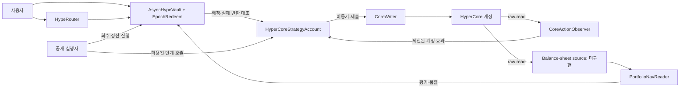
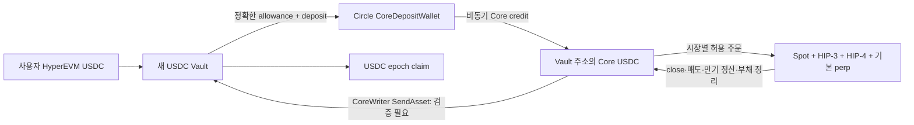

# Vault 프로젝트 아키텍처 기준선

> **이력 문서.** 공개 Factory·별도 Strategy 등 이전 설계를 포함한다. 현행 구조는 [hypervault-architecture.md](hypervault-architecture.md)(영문)와 [자산별 명세](managed-asset-vault.ko.md)를 따른다.

작성: 2026-10-02 KST. 최종 갱신: 2026-10-04 KST. 이 문서는 Vault 프로젝트의 구성 요소, 신뢰 경계, 회계 불변조건, 배포 단계별 허용 기능을 한곳에서 연결한다. **아키텍처 문서의 완성은 구현·실측·감사·배포 완료가 아니다.** WHYPE ABI는 [분리 구현 명세](split-implementation.ko.md), 새 USDC Vault ABI는 [USDC 구현 명세](usdc-vault-implementation.ko.md), 상태는 [STATUS](STATUS.ko.md), 미완료 작업은 [BACKLOG](BACKLOG.ko.md), 채택 결정은 [DECISIONS](DECISIONS.ko.md)가 관리한다.

## 1. 제품 경계와 배포 단위

**기존 WHYPE 프로토타입은 WHYPE 지분**이며 HYPE 담보와 같은 수량의 HYPE perp short를 조합한다. 새 제품 목표는 **HyperEVM USDC 입금·USDC 지분·USDC 출금과 HyperCore spot·HIP-3·HIP-4 거래**다. 현재 [USDC ERC7540 Vault](usdc-vault-implementation.ko.md)의 로컬 입출금·배정 경계만 구현됐고 단일 주소 Core 운용과 공개 Factory는 없다. validator 운영 perp도 목표 범위에 포함한다. 새 상품은 Hyperliquid의 기본 HyperCore Vault가 아니며 Vault 주소 자체가 Core 계정이다. 창설자는 Vault 운용자이고 다른 사용자가 USDC를 예치한다. 단일 HYPE carry가 새 제품의 고정 전략은 아니다. 수익이나 USDC 원금 보존을 약속하지 않는다. [ADR-003](DECISIONS.ko.md#adr-003)은 WHYPE 코드의 과거 기준선이고 [ADR-010](DECISIONS.ko.md#adr-010)·[ADR-011](DECISIONS.ko.md#adr-011)·[ADR-014](DECISIONS.ko.md#adr-014)·[ADR-015](DECISIONS.ko.md#adr-015)가 새 제품 목표다.

새 Managed USDC의 현재 ABI·proxy·커스텀 요율·최소 입금·실현 NAV와 남은 verifier는 [현행 명세](managed-usdc-vault-implementation.ko.md)를 따른다. 이 문서의 기존 WHYPE와 후속 기획을 구분한다.

현행 WHYPE의 Vault와 Strategy는 한 번 연결하는 **불변 배포 쌍**이다. 새 USDC 목표는 단일 Vault/Core 주소와 검증된 실행 모듈이다. reader, observer, oracle, 시장·자산·단위 설정은 배포 설정에 묶는다. 기존 WHYPE 계약은 새 계약·manifest와 사용자 재예치로 이전한다. 새 Managed USDC는 ADR-026에 따라 같은 proxy/Core 주소를 유지하는 owner 지연 업그레이드를 지원한다. ZEC 프로젝트나 다른 자산의 경로는 이 아키텍처의 범위 밖이다.

| 단계 | 허용할 제품 기능 | 아직 열지 않는 기능 | 다음 단계의 증거 |
| --- | --- | --- | --- |
| A: 현행 WHYPE 프로토타입 실험 | Idle WHYPE 입금, 하나의 운용 cycle, 전량 회수, epoch claim | 실자금 공개 입금, Active 입금, 부분 회수 | 통제 계정의 정상·실패 전후 원장과 실제 claim |
| B: USDC 경로·시장 통제 실험 | 새 USDC 쌍의 HyperEVM↔Core 왕복과 spot·HIP-3·HIP-4 각 시장의 주문·취소·평가·정산·회수 검증 | 공개 입금, Active 입금, 부분 회수 | [USDC-001](BACKLOG.ko.md#usdc-001)·[MARKET-001](BACKLOG.ko.md#market-001)의 시장별 실제 원장 |
| C: 다중 시장 USDC 배포 후보 | Idle USDC 입금·전량 회수·epoch claim, spot·HIP-3·HIP-4 중 전량 회수 가능한 허용 시장, 검증된 전체 NAV·위험 관측·운영 절차; 목표 운용 buffer 0 가능 | 즉시 출금, Active 입금, 지속 운용 partial exit, 외부 프로토콜 전략 | [REL-001](BACKLOG.ko.md#rel-001)의 시장별 Core/NAV/표준/보안·출금 대기 조건 |
| D: 후속 쌍 | 검증된 Active 가격의 동기 입금 | 부분 회수와 다중 전략 | [NAV-001](BACKLOG.ko.md#nav-001), [VAULT-001](BACKLOG.ko.md#vault-001) |
| E: 후속 쌍 | 검증된 NAV와 동일 epoch 전체 fulfillment를 이용한 부분 전략 회수; 필요하면 USDC buffer 정책 추가 | 여러 tranche의 부분 request fulfillment | [LIQ-001](BACKLOG.ko.md#liq-001) |
| F: 후속 쌍 | 외부 lending/LP 등 별도 custody adapter와 배분 | 기존 쌍의 암묵적 자산 변경 | [STRAT-001](BACKLOG.ko.md#strat-001) |

단계 A의 mock 통과는 B의 USDC·시장 경로 검증이나 C의 배포 허가가 아니다. USDC Vault의 새 mock 통과도 B의 통제 네트워크 왕복을 대체하지 않는다. 시장별 검증은 차례로 진행해도 다중 시장 상품의 출시 완료는 세 필수 시장의 검증을 모두 요구한다. 현재 프로젝트는 A의 통제 네트워크 왕복도 완료하지 못했다. 위 단계는 버전 번호나 이미 구현된 상태 enum이 아니다.

## 2. 구성 요소와 신뢰 경계

아래는 **현행 WHYPE 코드의** 구성도다. USDC 목표 경로는 7절에 별도로 명시한다.



| 경계 | 누가 권위를 갖는가 | 넘어오면 검증할 것 |
| --- | --- | --- |
| 사용자 → Vault | Vault 계약이 지분·request·claim 권리의 원본 | 실제 받은 WHYPE, receiver/controller, shares 반올림, cap, 역할 |
| Vault → Strategy | Vault가 배정·recap·반환 상대방을 고정 | cycleId, 실제 토큰 증감, 미예약 주주 현금, 고정 Vault 수령자 |
| Strategy → CoreWriter | Strategy 주소가 Core 계정 소유자·실행 주체 | chain·시장·lot·가격·health·deadline·한 개의 금융 pending |
| Core → Observer/Source | bounded raw precompile read; API는 진단 | 계정·block·범위·단위·부채·누락·시점; 실패를 0으로 바꾸지 않음 |
| 외부 운영자 → 계약 | keeper는 허용된 전이만 촉진; bootstrap은 PM 확인 기록 | keeper 수치를 NAV·receipt로 신뢰하지 않음; PM 확인은 protocol proof가 아님 |

Factory는 atomic pair 생성과 고정 연결만 한다. 사용자 자산 운용 권한이 없다. `FixedReceiverController`는 사용자가 controller로 선택했을 때 누구나 고정 beneficiary 지급을 촉진할 수 있게 한다. 표준 controller/operator claim 권한을 keeper에게 일반적으로 주지 않는다. [ADR-001](DECISIONS.ko.md#adr-001), [ADR-004](DECISIONS.ko.md#adr-004)

## 3. 회계와 권리 불변조건

1. **소유권 분리:** Vault 현금은 미예약 주주 현금과 확정 claim 준비금으로 구분한다. `reservedClaimAssets`는 신규 운용·recap·NAV에서 제외되며, 확정 claim은 시장 손익으로 다시 변경하지 않는다. 요청 escrow shares는 정산 전 공급량에 포함하고 정산 시 한 번 소각한다.
2. **한 번만 인식:** EVM→Core bridge, Core→EVM recall, 공급·상환, PnL·funding·fee는 같은 가치가 두 도메인이나 source 항목에 중복 들어가지 않아야 한다. 미확정 이동은 in-flight로 기록한다. 입금·배정·recap·회수 자체는 수익이 아니다.
3. **cycle 귀속:** principal, recap, 후원 gas, 외부 송금, 전 cycle의 잔여 자산을 서로 구분한다. 계정의 단순 잔액 증가만으로 이번 cycle 원금이나 주문 성공을 인정하지 않는다. 인증되지 않은 수신은 임의 claim 또는 다음 cycle의 몫으로 만들지 않는다.
4. **실제 지급:** epoch entitlement는 회수 완료 후 실제 미예약 WHYPE와 동일 epoch 환율로 확정한다. 반환 함수의 숫자와 Vault의 실제 잔액 증가를 대조한다. 같은 requestId의 controller는 동일 가격을 공유하고 각자의 entitlement만 청구한다.
5. **손실 처리:** 주주 NAV는 음수 Strategy equity를 반영하되 ERC4626 표시는 0으로 제한한다. 부채·청산·dust·gas 소모를 0으로 숨겨 장부를 맞추지 않는다. 전손에도 이미 확정한 claim 준비금의 법적·회계상 구분은 유지한다. 같은 Core 계정에 있는 gas 후원은 청산으로부터 물리적으로 분리되지 않는다.

세부 수식과 소유권 원장은 [NAV 설계](nav-liquidity-architecture.ko.md), [회계 기획](plans/accounting-fees.ko.md), 현재 epoch 수식은 [구현 명세](split-implementation.ko.md)를 따른다. 위 불변조건은 후속 구현의 검증 기준이며 미구현 source·gas ledger가 이미 이를 만족한다는 뜻이 아니다.

## 4. 운용 상태와 실패 정책

정상 순서는 `Idle 입금 → cycle 배정 → bridge 관측 → PM 확인 → 담보 준비 → short → Active → exit → close → 부채 정리 → 담보·quote 회수 → recall → 실제 반환 → epoch 정산 → claim`이다. `CoreWriter` 제출은 Core 실행 완료와 다르다. Strategy의 실제 enum·함수·권한은 [구현 명세](split-implementation.ko.md)가 관리한다.

| 관측 또는 사건 | 신규 위험 | 회수·기존 claim | 완료 판정 |
| --- | --- | --- | --- |
| PM/bridge 귀속 불명 또는 자동 공급 형태 불명 | 금지 | 이미 이동한 자산의 회수 근거 수집; 단순 raw spot target 우회 금지 | [CORE-001](BACKLOG.ko.md#core-001) 실측 뒤 |
| 금융 action의 성공/실패/잔여 실행 가능성 불명 | 같은 의도 재제출 금지 | pending 보존, 관측·진단; 안전한 축소 가능 범위만 실행 | receipt 또는 명시적 신뢰 모델 필요 |
| read 실패·ABI 오류·범위 누락·오래된 가격 | 가격을 쓰는 입금·주문 금지 | 독립적인 기존 claim은 유지 | 완전한 재관측 뒤 |
| 확인된 부채·잔여 quote·gas 귀속 불일치 | 금지 | 실제 자산/부채 정리 전 terminal·settle 금지 | [CORE-003](BACKLOG.ko.md#core-003), [CORE-004](BACKLOG.ko.md#core-004), [CORE-005](BACKLOG.ko.md#core-005) |
| pause·shutdown·기한 도달 | 신규 배정·위험 증가 금지 | 기존 pending을 지우지 않고 허용된 exit 진행 | 실제 반환과 준비금 대조 뒤 |

**안전성과 진행성의 경계:** 현재 `ExpectedEffect`는 계정 변화이지 cloid별 확정 receipt가 아니다. 최종 실패와 늦은 실행을 구별할 증거가 없으면 자동 재시도를 허용하지 않는다. 그 경우 출금이 무기한 멈출 수 있으며 `permissionless`가 무조건적인 지급 보장을 뜻하지 않는다. 운영자가 개입할 수 있다는 이유로 임의 잔액이나 HTTP 응답을 온체인 확정 증거로 승격하지 않는다. 출시 전에 [CORE-002](BACKLOG.ko.md#core-002)의 protocol-verifiable 근거나 별도 채택한 명시적 attestation 신뢰 모델, 그리고 장애 시 사용자 권리 처리를 확정해야 한다. [ADR-005](DECISIONS.ko.md#adr-005)

## 5. NAV·입금·출금의 버전 경계

현재 기본 reader의 Active `totalAssets()`는 WHYPE 원금 추정치다. 조회 가능하다는 이유로 지분 발행 가격, 부분 출금 가격, 공정 성과 지표가 되지 않는다. 후속 USDC 배포 후보도 입금은 완전 Idle에서만 허용하고, 출금은 cycle 전체 회수 후 **실현 USDC**로 정산한다. 배포 후보의 위험·성과 관측에는 범위와 가격이 검증된 생산용 source가 필요하며, 그 source의 존재만으로 Active 입금을 열지 않는다.

후속 Active 입금은 한 트랜잭션 안의 **입금 직전** 검증 NAV로만 발행한다. 후속 부분 회수는 sealed epoch 전체를 같은 최종 가격에 함께 fulfillment하고, 필요한 전략 자금만 일부 회수한다. pending/in-flight나 불완전 source에서는 가격 확정을 금지한다. 이 기능들은 [NAV-001](BACKLOG.ko.md#nav-001) → [VAULT-001](BACKLOG.ko.md#vault-001) → [LIQ-001](BACKLOG.ko.md#liq-001) 순서로 검증하고 새 불변 배포 쌍에 반영한다.

첫 USDC 후보는 ERC4626 기반 USDC 지분과 ERC7540 동기 입금/비동기 출금이다. 내부에서 여러 시장 자산을 보유해도 사용자의 입출금 자산은 USDC 하나이므로 다중 입금 진입점을 만들지 않는다. 목표 운용 buffer를 0으로 둘 수 있지만 확정 claim 준비금은 계속 격리한다. 출금 가능 시점은 시장별 전량 회수·실제 USDC 반환에 달렸으며, 특히 만기 전 환금 경로가 없는 HIP-4 outcome은 허용 시장에 넣지 않는다. [ADR-012](DECISIONS.ko.md#adr-012)

## 6. 아키텍처 인계와 남은 결정

| 항목 | 현재 설계 기준 | 완료를 가르는 근거 |
| --- | --- | --- |
| PM/자동 공급 | baseline·bridge·PM·담보를 별도 사건으로 기록; 불명확하면 신규 short 금지 | 통제된 계정의 전후 원장, 자동 공급·회수·다음 cycle |
| 액션 최종성 | pending 보존, 증거 없는 timeout reset 금지 | 액션별 receipt 범위 또는 신뢰 모델 결정과 늦은 체결 시험 |
| recall·dust·gas | 실제 순수령과 소유권 원장; 잔여를 묵시적 0/다음 cycle로 처리 금지 | sender/fee/net, dust 처분, gas 소모·후원 실측 |
| NAV·위험 | 동일 범위·시점·quote, signed equity, 명시적 가격 freshness | 완전한 source와 health 스트레스 시험 |
| 상품 정책·운영값 | 현행 WHYPE 프로토타입과 별도 USDC 목표 쌍; 첫 배포의 목표 운용 buffer 0 가능, USDC 출금 이익 10% 수수료는 ADR-016, 이후 buffer 크기·cap 등은 OPEN 등록부 | USDC 경로·수수료 원장, parameter profile, 역할·주소 manifest |

구현 순서와 완료 조건은 [BACKLOG](BACKLOG.ko.md)의 USDC-001/002, MARKET-001/002, CORE-001~006, NAV-001, STD-001, REL-001을 따른다. 아키텍처가 닫혀 있어도 외부 사실을 확인하지 못한 분기는 `CONDITIONAL`로 남긴다. 이 문서만으로 현재 프로토타입을 운용 가능하다고 표시하지 않는다.

<a id="7-usdc-목표-경로와-검증-조건"></a>
## 7. USDC 목표 경로와 검증 조건



1. 사용자는 Circle native USDC를 **새 Vault의 HyperEVM 주소**에 ERC20 입금한다. Vault는 실제 수령액에 따라 지분을 발행한다. EVM gas는 HYPE이므로 사용자·keeper의 실행 가스 경로를 별도로 준비한다.
2. 배정 시 Vault는 정확한 USDC allowance를 부여하고 `CoreDepositWallet.deposit(amount, destinationDex)`를 호출한다. 이는 호출자 Vault와 같은 주소의 Core 잔액을 credit한다. `depositFor(address(this), ...)`도 주소상 가능하지만 두 경로 중 하나만 배포 템플릿에서 고정한다. spot·outcome 거래에 필요한 자금 경로를 우선 검증하되, HIP-3 담보 DEX와 계정 모드를 포함한 최초 운용 경로가 확인되기 전에는 목적지를 운영 설정으로 확정하지 않는다. Circle 문서는 `CoreDepositWallet`에 **직접 ERC20 송금하면 입금되지 않고 자금이 묶인다**고 명시한다. 일반 linked token의 시스템 주소 전송 설명을 USDC의 채택 경로로 대체하지 않는다.
3. Vault는 받은 USDC를 배정할 때 별도 사람의 입금 승인·사전 확인을 기다리지 않는다. Core 자금으로 매수/short를 시작하는 다음 단계에서 intent ID·전송량·EVM tx/Core block·이전 baseline과 출처 증거를 묶어 **Vault 주소 Core 계정**의 사용 가능 잔액을 확인한다. HyperEVM→Core 이동은 EVM 블록 구성 뒤 처리되므로 같은 EVM 블록의 CoreWriter 거래 성공을 가정하지 않는다. 신규 Core 계정은 [공개 Factory 활성화 흐름](#9-공개-factory와-core-활성화)에서 먼저 준비한다.
4. 회수 시 열린 perp·HIP-3 포지션을 닫고 spot을 USDC로 매도하며 HIP-4 outcome의 매도 또는 만기 정산을 처리한다. 부채·수수료·잔여량과 DEX별 담보를 정리한다. 그 후 **Vault 자신의 CoreWriter 호출**로 같은 주소의 EVM 수령 경로에 USDC를 보내는 안을 통제된 계약 계정에서 검증한다. 사용한 source DEX와 account mode에 따라 출금 가능액이 달라질 수 있다. Vault EVM 주소의 실제 USDC 증가와 출처를 확인한 뒤 정산한다.
5. Circle native USDC는 HyperEVM에서 6 decimals이고 공식 spot metadata 예시의 Core USDC는 8자리다. 실제 배포 대상 metadata를 확인해 정수 변환을 고정하며 값이 같아 보이는 raw 정수를 그대로 더하지 않는다. NAV source의 quote와 Vault asset이 모두 USDC여도 spot token·기본/HIP-3 perp·HIP-4 outcome·부채의 가격과 손익은 검증해야 한다. Core spot USDC와 DEX별 계정 가치, outcome payout을 중복 합산하지 않는다. Core credit/net, 1회성 계정 활성화 비용, DEX 간 이동, quote dust, EVM gas, 준비금 귀속을 원장에 따로 기록한다.

이 경로는 [ADR-010](DECISIONS.ko.md#adr-010)의 USDC 자산·이동과 [ADR-014](DECISIONS.ko.md#adr-014)의 단일 주소를 결합한 목표 구조다. 이전 `AsyncUsdcVault`는 별도 Strategy형이며, 단일 주소 그림은 새 `ManagedUsdcVault/Factory`에 로컬 구현했다. Circle 계약 발신 입금의 Vault Core credit, 계약 발신 `SendAsset`의 실수령, 계정 모드·PM 자동 공급, 모든 반환 비용은 아직 프로젝트 소유 계정에서 관측되지 않았다. [USDC-001](BACKLOG.ko.md#usdc-001)을 통과하기 전에는 구현 완료나 출금 가능성을 주장하지 않는다. 공식 경로: [Circle 입금 인터페이스](https://developers.circle.com/cctp/references/coredepositwallet-contract-interface), [Circle 입금 절차](https://developers.circle.com/cctp/howtos/transfer-usdc-from-hyperevm-to-hypercore), [HyperCore/EVM 타이밍](https://hyperliquid.gitbook.io/hyperliquid-docs/for-developers/hyperevm/interaction-timings).

Vault 주소의 비요청 HyperEVM USDC는 [ADR-013](DECISIONS.ko.md#adr-013)에 따라 주주 현금 장부에서 격리한다. 제3자가 Vault 주소를 수신자로 지정한 `depositFor`와 Core 토큰 송금은 이 EVM 장부만으로 출처를 증명할 수 없다. 생산용 Core 실행 로직은 이를 원금 도착·거래 수익·회수분으로 오인하지 않도록 별도 수신 귀속과 미확인 자산 중단 조건이 필요하다.

<a id="8-usdc-다중-시장-거래-아키텍처"></a>
## 8. USDC 다중 시장 거래 아키텍처

**제품 경계:** Hyperliquid의 [기본 HyperCore Vault 설명](https://hyperliquid.gitbook.io/hyperliquid-docs/hypercore/vaults/for-vault-leaders-legacy)은 validator 운영 perp만 거래하고 spot·HIP-3는 지원하지 않는다고 한다. 우리 상품은 기본 Vault의 leader/subaccount 권한을 쓰지 않고, HyperEVM Vault 주소의 일반 Core 계정을 사용한다. 따라서 Core 계정이 해당 시장에서 실제로 거래·청산·회수 가능한지는 시장별로 검증해야 한다. HIP-4는 [제한된 mainnet 초기 출시](https://t.me/s/hyperliquid_announcements/550) 후 확장 중이므로 임의 outcome을 모두 지원한다고 표시하지 않는다.

| 시장 | 주문/상태 경계 | USDC 회계·회수의 추가 조건 |
| --- | --- | --- |
| 기본 perp | 기본 DEX asset ID, position·funding·margin·open order | 부채/담보, 미실현 PnL, close 후 사용 가능 USDC |
| HIP-3 perp | DEX index가 포함된 asset ID, DEX별 position·담보·margin mode·halt/settlement | DEX별 독립 상태와 quote collateral, 환산·회수 경로; 기본 perp만 조회해 NAV 확정 금지 |
| HyperCore spot | spot pair ID와 token ID 구분, 각 토큰 balance·hold·open order | USDC 외 보유 토큰의 검증 가격·매도 유동성·dust·수수료 |
| HIP-4 outcome | outcome ID/side에서 파생된 asset ID, 시장별 만기·정산 상태 | outcome token의 미결제 가치, 만기 payout·지연·정산 후 USDC; 미결제 금액을 확정 USDC로 기록 금지 |

[공식 asset ID 명세](https://hyperliquid.gitbook.io/hyperliquid-docs/for-developers/api/asset-ids)는 HIP-3 `100000 + dexIndex × 10000 + marketIndex`, spot `10000 + pairIndex`, outcome `100000000 + (10 × outcomeId + side)`를 사용한다. 이는 인코딩 형식이며 실제 시장 존재·유동성·계정 거래 권한·CoreWriter 처리 성공의 증거는 아니다. [ADR-023](DECISIONS.ko.md#adr-023)의 owner 신뢰 모델에서는 API wallet이 직접 주문하며 EVM 시장 allowlist·노출 상한의 주문별 강제를 요구하지 않는다. 시장별 adapter/indexer는 상태·가치·회수 가능성을 관측한다. 지원하지 않는 자산을 운용자가 거래하면 그 자산을 0으로 누락하지 않고 자동 NAV/정산을 미확인으로 유지한다.

**공통 원장:** Vault의 1 share 가격은 USDC 기준 전체 순자산에 대한 청구권이다. 전체 순자산은 EVM 미예약 USDC, Core의 DEX별 사용 가능 자산, spot/outcome token 가치, perp equity와 부채, 미확정 이동·주문·정산·수수료를 중복 없이 합산한다. 시장별 raw 조회가 실패하거나 대상 DEX/토큰을 빠뜨리면 신규 share 가격이나 출금 epoch를 확정하지 않는다. 전략이 여러 시장을 동시에 쓰는 경우 한 시장의 수익으로 다른 시장의 미확정 손실을 숨기지 않는다. HIP-4 만기 정산을 기다리는 자산을 즉시 출금 가능한 USDC로 광고하지 않는다.

**주문 권한과 builder fee:** 현행 `CoreActions.order`는 CoreWriter action 1만 인코딩하며 builder 필드가 없다. 새 상품은 owner의 API 직접 주문을 사용하고, Vault의 `onlyOwner` 함수로 action 9 등록과 action 12 승인 등을 제공한다. 구체적 함수는 [운용자 신뢰형 관리 아키텍처](managed-usdc-vault-architecture.ko.md#4-목표-함수와-권한)를 따른다. Builder fee 승인은 한도 설정일 뿐 주문마다 `builder`를 지정해야 fee가 붙으며 agent가 모든 주문에 이를 포함하도록 Vault가 강제하는 구조는 아니다. 플랫폼 수익의 기본 경로는 출금 성과 수수료 배분이다. 시장별 적용 가능성, builder 주소 요건, 주주 비용 귀속은 [MARKET-002](BACKLOG.ko.md#market-002)에서 검증한다. [공식 CoreWriter](https://hyperliquid.gitbook.io/hyperliquid-docs/for-developers/hyperevm/interacting-with-hypercore), [Builder code](https://hyperliquid.gitbook.io/hyperliquid-docs/trading/builder-codes)

**Vault 전용 API wallet 실행 경계:** [ADR-022](DECISIONS.ko.md#adr-022)에 따라 창설자가 오프체인에서 Vault 전용 키를 만들고 활성화된 Vault 자신의 CoreWriter action 9로 그 주소를 **Vault Core 계정의 agent**로 등록한다. API wallet은 Vault Core 자산의 소유자가 아니며 직접 서명한 주문은 EVM 사전 검사를 거치지 않는다. `agentSendAsset`은 동일 주소 내 계정/DEX 간 이동이 가능하므로 EVM 함수의 allowlist만으로 자산·위험 정책을 강제한다고 표시하지 않는다. Vault 계약이 action 15 공급/회수와 action 16 계정 추상화 전환을 맡고 Core 처리 결과를 후속 관측한다. API `agentSetAbstraction`은 존재하지만 공식 SDK 예시가 초기 default 모드 제약을 명시하며, agent 서명 `borrowLend`는 공식 Exchange 명세에서 확인되지 않았다. 계약 Core 계정에 등록된 agent의 실제 거래 귀속 및 철회는 메인넷 소액 실험 조건이다. [CoreWriter 액션 표](https://hyperliquid.gitbook.io/hyperliquid-docs/for-developers/hyperevm/interacting-with-hypercore), [Exchange API](https://hyperliquid.gitbook.io/hyperliquid-docs/for-developers/api/exchange-endpoint)

**확정된 owner 모델:** [ADR-023](DECISIONS.ko.md#adr-023)은 매매·담보 판단을 창설자에게 맡기는 사용자 합의를 반영한다. Factory 호출자는 해당 Vault의 변경 불가 owner이며 별도 owner whitelist는 필요 없다. 관리 함수는 onlyOwner, 거래는 등록한 API wallet, 지분·원가·준비금·claim은 Vault 계약이 담당한다. Core 회수는 운용자가 진행하고 이미 확정된 claim은 owner 승인 없이 청구한다. 전체 함수·권한과 생성/회수 흐름의 관리 원본은 [운용자 신뢰형 상세 아키텍처](managed-usdc-vault-architecture.ko.md)다.

HIP-3·spot·HIP-4는 외부 lending/LP를 추가하는 후속 [STRAT-001](BACKLOG.ko.md#strat-001)과 다르다. 세 시장은 첫 USDC 상품의 거래 범위다. [MARKET-001](BACKLOG.ko.md#market-001)의 시장별 통제 거래와 NAV/exit 원장 없이는 이 제품의 기능이 완료됐다고 표시하지 않는다.

<a id="9-공개-factory와-core-활성화"></a>
## 9. 공개 Factory와 EVM 입금 기준 지분 발행

[ADR-021](DECISIONS.ko.md#adr-021)의 첫 공개 생성 경로는 **EVM USDC 수신 시 창설자 share 발행**과 **후속 Core 운용 가능 확인**을 분리한다. 누구나 `createVaultAndFund`로 자신이 운용할 Vault를 만들고, 창설자 자기자본 100 USDC를 같은 EVM 거래에서 납입한다. Vault가 정확한 ERC20 `transferFrom` 증가량을 확인하고 초기 환율 1 USDC당 1 share로 창설자에게 100 share(9자리 단위 `100e9`)를 발행한다. 활성화 비용은 별도 창설자 부담이며 원금·share·성과 수수료 원가가 아니다. 첫 생성 거래에서 Vault가 Circle `CoreDepositWallet.deposit`으로 자기 Core 주소에 자금을 배정할 수 있지만, Core 수령 검증은 **지분 발행 조건이 아니라 운용 개시 조건**이다. 정확한 gross→net과 비용 위치는 [USDC-001](BACKLOG.ko.md#usdc-001)의 통제 거래 전 고정하지 않는다. [Circle 입금 인터페이스](https://developers.circle.com/cctp/references/coredepositwallet-contract-interface)

```text
창설자: Factory에 HyperEVM USDC 사용 승인
Factory.createVaultAndFund(검증된 설정, 창설자 원금 100, 별도 활성화 예산)
  → Vault 배포·창설자 고정
  → USDC 실제 수령액 확인; 같은 EVM 거래에서 창설자 share 100 발행
  → Vault의 Circle deposit 실행 시 EVM 차감·allowance 확인
  → pendingCoreAllocation 기록; AwaitingActivation
후속 EVM 블록: 누구나 finalizeActivation 호출
  → Vault가 Core userExists·정확한 USDC spot balance 직접 확인
  → 100 순수령/비용·초과분 확인 후 Ready; _mint 재호출 없음
  → 실패·조회 오류·부족액이면 일반 입금·거래 중단, 복구/손실 처리
```

창설자 지분은 Vault에 **실제 들어온 EVM USDC**에 근거하므로 Core 잔액을 통한 송금인 추정이 필요 없다. 반대로 Core 이동 성공을 지분의 자산 가치가 보장됐다는 뜻으로 표시하지 않는다. 이동 중 원금은 `pendingCoreAllocation`으로 보관하고, Core 도착 확인 시 확인된 Core 자산으로 재분류한다. EVM 현금·인플라이트·Core 자산을 중복 합산하지 않는다. EVM 거래 전체가 실패하면 배포·USDC 이체·share 발행도 되돌아가지만, EVM 성공 후 Core 실패는 소급 revert가 아니다. 창설자 share는 남고 입금·거래를 멈추며 재조회·검증된 Core→EVM 회수·자산 가치 조정과 필요 시 창설자 추가 비용 부담을 처리한다. 수수료 1 USDC가 100 원금에서 빠져 순자산 99가 된 경우를 100이라고 주장하지 않는다. [Hyperliquid 처리 순서](https://hyperliquid.gitbook.io/hyperliquid-docs/for-developers/hyperevm/interaction-timings), [활성화 비용](https://hyperliquid.gitbook.io/hyperliquid-docs/for-developers/api/activation-gas-fee)

**일반 사용자 입금:** Vault의 HyperEVM `deposit/mint`만 지분을 발행한다. 실제 ERC20 수령액·검증된 NAV/가격·한도에 따라 같은 거래에서 발행하고, Core 배정은 그 뒤 Vault의 내부 운용이다. 첫 배포는 모든 자산 회수와 실현 NAV가 확인된 Idle 입금 창에서만 이를 허용한다. Core 포지션이 Active일 때 상시 입금을 열려면 spot·기본 perp·HIP-3·HIP-4 전체 NAV의 생산용 검증 또는 별도 ERC-7540 비동기 입금 설계가 필요하다. 잔액 조회 실패를 0으로 바꾸지 않는다. 사용자가 Vault EVM 주소에 USDC를 **단순 전송**하거나 Circle `depositFor(vault, ...)`로 Vault Core에 직접 credit해도 share는 발행되지 않으며 [ADR-013](DECISIONS.ko.md#adr-013)의 비요청 자금으로 격리한다. `CoreDepositWallet` 주소에 직접 USDC를 보내는 행위는 Circle 문서상 자금이 묶이므로 금지한다. [ERC-7540 동기 입금 선택](DECISIONS.ko.md#adr-012), [Circle 경고](https://developers.circle.com/cctp/references/coredepositwallet-contract-interface)

**Core 보유자 입금:** 사용자는 Core spot/perp USDC를 [Circle의 Core→HyperEVM 출금](https://developers.circle.com/cctp/howtos/withdraw-usdc-from-hypercore-to-hyperevm)으로 **자기와 같은 EVM 주소**에 옮긴다. 도착 후 창설자는 `createVaultAndFund`, 다른 사용자는 Vault `deposit/mint`를 호출한다. UI는 두 단계를 하나의 안내 흐름으로 묶을 수 있지만 원자적 거래·직접 Core Vault 입금으로 표시하지 않는다. Core 출금과 HyperEVM Vault 호출의 HYPE 가스 잔액을 각각 준비하거나 명시적으로 후원해야 한다. Circle의 동일 주소 제한 때문에 사용자가 Core에서 Vault EVM 주소를 출금 수령자로 지정할 수 없다. Core에서 Vault Core 주소로 바로 보내도 Vault의 온체인 잔액 조회는 **개별 송금인·금액 귀속을 증명하지 못해** 사용자 share를 안전하게 발행할 수 없다. 사용자별 수신 계약을 두는 고급 경로는 새 Core 계정 활성화 비용·CoreWriter 이동·비동기 NAV/회수·비요청 송금 정책이 추가되므로 첫 배포에서 제외한다. [ADR-021](DECISIONS.ko.md#adr-021), [FACTORY-001](BACKLOG.ko.md#factory-001)

Factory는 동일한 검증 코드·고정 자산과 허용 시장 모듈만 배포한다. Vault 주소 자체가 Core 계정·CoreWriter caller이고, Factory나 운용자는 창설자 또는 예치자의 Core 잔액을 임의로 인출하지 못한다. Core 수령 후 `finalizeActivation`은 새 share를 만들지 않고 운용 가능 상태만 확인한다. 계정 선제 활성화·예상 밖 Core 자산·재진입/중복 전이·복구 실패와 EVM/Core 단위 변환은 생산 전 통제 실험이 필요하다. 현재 저장소에는 단일 주소 USDC Vault, 공개 Factory, 생성 시 창설자 share·Core 배정, activation gate, Core source 검증이 없다. 현행 WHYPE `VaultFactory.createPair`은 이 기능의 구현이 아니다. [FACTORY-001](BACKLOG.ko.md#factory-001), [USDC-001/002](BACKLOG.ko.md#usdc-001)

첫 Core 수신은 Vault의 Circle `deposit`이 맡는다. 이 호출은 **CoreWriter 액션이 아니며**, 신규 Core 계정의 첫 수신에는 1 quote-token 활성화 비용이 든다. 생성 거래는 창설자가 EVM HYPE로 가스를 내고, 후속 `finalizeActivation`은 이를 제출하는 창설자 또는 keeper가 EVM HYPE로 가스를 낸다. 운용 중 Vault가 CoreWriter를 내부 호출할 때에도 EVM 거래 제출자가 가스를 부담하므로, 내부 호출만을 위해 Vault EVM 주소에 HYPE를 선입금할 필요는 없다. 반면 Core→EVM 회수 때의 Core spot HYPE 비용은 [CORE-005](BACKLOG.ko.md#core-005)에서 별도로 확인한다. **계정이 EVM 블록 구성 전에 Core에 존재해야** CoreWriter가 처리되므로 생성 거래·같은 EVM 블록에서는 CoreWriter 주문을 제출하지 않는다. [공식 활성화 비용](https://hyperliquid.gitbook.io/hyperliquid-docs/for-developers/api/activation-gas-fee), [처리 순서](https://hyperliquid.gitbook.io/hyperliquid-docs/for-developers/hyperevm/interaction-timings), [EVM HYPE 가스](https://hyperliquid.gitbook.io/hyperliquid-docs/support/faq/hyperevm-issues/gas-problem-on-evm)

이 설계의 `finalizeActivation`은 Vault가 Core read로 계정 존재·USDC 수령을 확인하는 함수 가칭이다. 이름이 비슷한 CoreWriter **action 8 `Finalize EVM Contract`**는 Core spot 토큰을 EVM 토큰 컨트랙트와 연결할 때 토큰 배포자·finalizer가 쓰는 액션이다. Vault 생성, 계정 활성화, Circle USDC 입금에서는 action 8을 호출하지 않는다. [공식 토큰 연결 절차](https://hyperliquid.gitbook.io/hyperliquid-docs/for-developers/hyperevm/hypercore-less-than-greater-than-hyperevm-transfers)

**입금의 동기·후속 경계:** Vault가 `transferFrom`으로 받은 EVM USDC를 근거로 같은 EVM 거래에서 share를 발행할 수 있다. Vault가 그 거래에서 Circle `deposit`까지 호출한다면, Circle의 ERC20 이체·EVM 검사 실패는 거래 전체를 되돌린다. 반면 Circle 공개 구현은 Core 입금을 위한 이벤트를 EVM에서 내보내고, Hyperliquid는 EVM 블록 생성 뒤 EVM→Core 이전을 처리한다. 성공한 EVM receipt만으로 Core 계정 생성·순수령액을 확정할 수는 없다. `finalizeActivation`은 지분 발행을 지연시키는 함수가 아니라 후속 Core 준비 상태를 확인하는 함수다. 첫 제품은 Vault의 **Core spot 입금**을 기본 후보로 삼는다. Circle의 perp 목적지 경로에는 Circle 자체의 CoreWriter 전달이 추가되므로 분리 검증한다. [Circle 공개 구현](https://github.com/circlefin/hyperevm-circle-contracts/blob/master/src/CoreDepositWallet.sol), [공식 처리 순서](https://hyperliquid.gitbook.io/hyperliquid-docs/for-developers/hyperevm/interaction-timings)

<a id="10-운용자-성과-수수료"></a>
## 10. 운용자의 출금 성과 수수료

[ADR-016](DECISIONS.ko.md#adr-016)에 따라 공개 USDC Vault의 다른 예치자 수익에 성과수수료를 징수한다. ADR-026 이후 요율은 **기본 10%인 생성 시 선택값**이다. [ADR-017](DECISIONS.ko.md#adr-017)에 따라 수수료의 80%는 창설자/운용자, 20%는 플랫폼에 배분한다. 요청된 share의 사용자별 납입 원가와 이전 확정 손실을 별도 장부에 묶는다. 실제 USDC 회수에 따라 총 출금 권리가 정해지면 손실을 먼저 상쇄하고 남은 이익에 요청의 고정 요율을 적용한다. Claim에서는 사용자 순수령액·운용자 몫·플랫폼 몫을 같은 EVM 거래로 지급한다. 운용자 자신의 share와 활성화 자금은 과금 대상이 아니다. [수식·준비금·표준 경계](performance-fee-architecture.ko.md)

예치자가 100 USDC를 넣고 출금 시 총 120 USDC를 받을 권리가 생겼다면 수수료 2 USDC(운용자 1.6, 플랫폼 0.4), 실제 사용자 수령 118 USDC다. 총 권리가 80 USDC라면 수수료는 0이고 20 USDC 손실을 같은 주소의 후속 이익에서 먼저 회복한다. `requestRedeem` 시점에는 실제 Core 회수가 끝나지 않았으므로 예상 수수료만 표시한다. Claim 가능한 금액과 fee는 회수·정산 이후 확정한다.

현행 [`EpochRedeem`](../src/vault/EpochRedeem.sol)은 같은 epoch의 모든 controller에 하나의 외부 request ID와 환율을 적용한다. 사용자마다 원가와 수수료가 달라지면 ERC-7540의 동일 ID 동일 환율 조건과 충돌하므로, 유료 템플릿은 내부 epoch와 외부 사용자별 요청 ID를 분리해야 한다. 최종 총 권리 **전액**을 Claim 전 지급 준비금으로 잠그며 수수료만 선인출하거나 다음 운용에 쓰지 않는다. 이 기능은 새 `ManagedRedeem`에 구현했다. 실제 정산 근거와 전체 표준 검토는 남아 있다. [FEE-001](BACKLOG.ko.md#fee-001)
