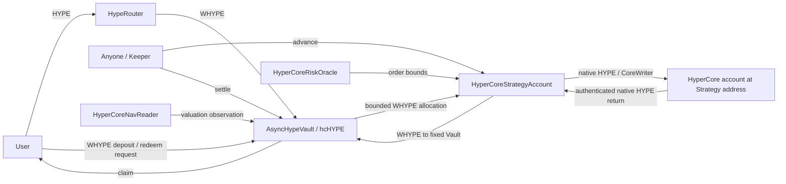
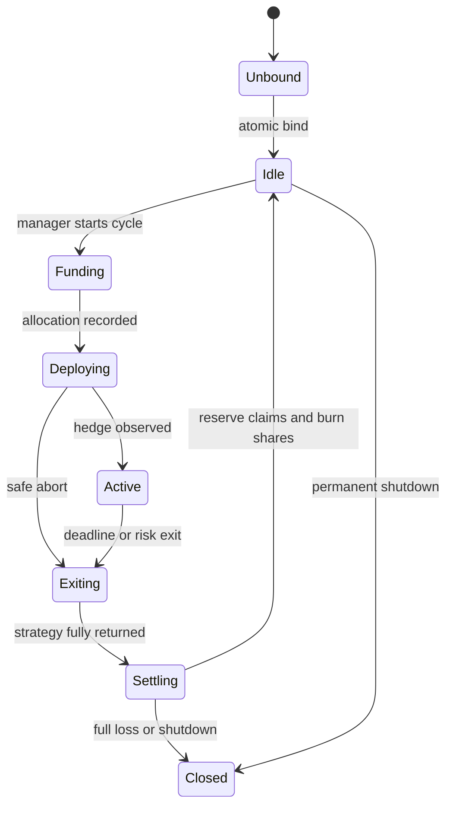

# ERC-7540 Vault / HyperCore StrategyAccount 분리 기획

작성일: 2026-09-20 KST. 상태: 최초 설계안 보존. 작성 당시 `src/HyperCoreVault.sol`은 기존 프로토타입이며 이 문서의 분리 구조는 구현 전이었다.

후속 작업으로 분리 계약과 테스트가 추가되었다. 현재 동작은 [분리 구현 명세](split-implementation.ko.md), 최신 상태는 [STATUS](STATUS.ko.md), 남은 작업은 [BACKLOG](BACKLOG.ko.md)를 따른다. 이 문서는 최초 설계안을 보존하며 현행 설계 결정은 [DECISIONS](DECISIONS.ko.md)에서 관리한다.

구체적인 파일·상속·함수·저장소 변경은 [컨트랙트 구현 변경 기획서](contract-change-spec.ko.md)를 따른다. ERC-7540은 Ethereum 표준이고 OpenZeppelin은 구현 기반 라이브러리다.

## 1. 제품 범위와 기본 결정

포트폴리오 마진(PM)을 사용할 수 있다는 전제로 설계한다. 사용자는 HYPE를 예치하고 `hcHYPE` 지분을 받는다. 전략은 HYPE 현물/담보를 보유하면서 같은 수량의 HYPE perpetual short를 운용한다. 출금은 일정한 정산 구간(epoch)에 모아 전략 전체를 회수한 뒤 지급한다.

| 항목 | v1 결정 |
|---|---|
| 회계 및 지급 자산 | WHYPE 한 종류, native HYPE는 router에서 변환 |
| 지분 | Vault 자체의 양도 가능한 ERC-20 `hcHYPE`; 수익으로 잔액을 자동 증감시키지 않음 |
| 표준 목표 | ERC-4626을 확장한 ERC-7540 비동기 출금; ERC-7575 `share()`와 ERC-165 포함 |
| 입금 | 자산이 완전히 EVM에 돌아온 Idle에서 동기 입금; 운용 중에는 닫음 |
| 출금 | 모든 상태에서 동일한 request/claim 의미; Idle에서는 즉시 Claimable 가능 |
| 초기 전략 | HYPE 수량 1:1 hedge; 추가 차입 후 현물 재매수는 범위 밖 |
| 정산 | 한 cycle의 전체 포지션 회수; 요청 지분에 해당하는 금액만 claim reserve로 분리 |
| 수수료 | v1 관리/성과 수수료 0; 거래·차입·Core 전송 비용은 해당 cycle 손익에 반영 |
| 상품 격리 | Vault 하나에 StrategyAccount 하나; 다른 위험/레버리지 상품은 별도 쌍 배포 |
| 업그레이드 | v1 proxy 없음. 연결된 StrategyAccount 교체 및 임의 call/delegatecall 없음 |
| API wallet | 등록하지 않음. keeper는 EVM 함수 호출만 수행 |
| 요청 취소 | v1에서는 제외. 출금 큐·회수·claim을 우선 완성 |

`hcHYPE`는 일정 수량 HYPE의 반환 약속이 아니라 순자산의 비례 지분이다. 이 전략은 USD 기준 가격 노출을 줄이므로 HYPE 환산 지분 가격은 HYPE/USD 가격에 따라 내려갈 수도 있다. 화면에는 share 수량, WHYPE 기준 추정 가치, USD 참고 가치, 확정 출금액을 구분한다.

## 2. 사용자 여정

1. **입금:** Idle에 HYPE/WHYPE를 입금한다. native HYPE는 router가 감싼다. 당시 확정된 순자산 기준으로 share가 즉시 발행된다.
2. **운용:** 운영자가 공개된 한도 내에서 cycle을 시작한다. 이후 정해진 단계는 누구나 진행할 수 있다. share는 일반 ERC-20처럼 전송 가능하다.
3. **출금 요청:** 보유 share 중 원하는 수량을 잠근다. 받을 WHYPE 수량은 아직 고정하지 않는다. 사용자는 controller가 되고 요청은 epoch에 묶인다.
4. **회수:** cycle 마감 이후 누구나 close/repay/withdraw/recall을 진행한다. 마감 시각은 청산 시작 가능 시각이며 지급 완료 시각을 보장하지 않는다.
5. **정산:** 실제 WHYPE가 Vault에 도착하고 Core 채무가 해소됐을 때 환율을 확정한다. Pending share도 이때까지 손익을 부담한다.
6. **수령:** controller 또는 승인 operator가 `redeem/withdraw`로 WHYPE를 받는다. HYPE 수령은 router를 사용한다. 미수령 확정 자금은 다음 cycle에 사용하지 않는다.

운용 중 상시 입금은 v2에서 `requestDeposit` escrow로 추가한다. 신규 입금 대기금을 기존 전략 손실 상환에 사용하는 것을 금지한다.

## 3. 컨트랙트 경계



| 구성요소 | 소유 데이터와 책임 | 허용하지 않는 일 |
|---|---|---|
| `AsyncHypeVault` | shares, ERC-7540 권한, epoch, claim 채무, 자금 배정, 가격 변환 | CoreWriter 직접 호출, keeper 입력 NAV로 share 가격 확정 |
| `HyperCoreStrategyAccount` | Core 자산, PM 설정, supply, position, debt, pending action, recall 영수증 | shares 발행, 사용자별 지분 계산, 임의 주소로 자산 출금 |
| `HyperCoreRiskOracle` | 허용 시장, 가격/lot/노출/건전성 검증 | 자금 보관, NAV/epoch 가격 임의 지정 |
| `HyperCoreNavReader` | Core 순자산 관측, 중복 제거, valuation 상태/시각 | 자금 보관, 무검증 외부 숫자 승인 |
| `HypeRouter` | wrap/unwrap, 최소 수령량/만료 시각 검사, 필요 시 사용자 claim 대행 | pool NAV 계산, 운영자 역할, 임의 controller 자금 사용 |
| `VaultFactory` | 한 트랜잭션 안에서 쌍 배포·연결 | 배포 후 연결 교체, 자산 회수, 운용 |

**Core 소유 주소는 StrategyAccount다.** HYPE 시스템 전송, PM 설정의 `user`, Core read 대상, CoreWriter caller를 모두 StrategyAccount 주소로 통일한다. Core 회수 역시 먼저 StrategyAccount의 EVM 주소로 돌아온다. 이후 StrategyAccount가 wrap하여 고정 Vault로 보낸다. 기존 Vault 주소를 Core read에 그대로 남기는 오류를 테스트로 잡는다. [CoreWriter 호출 주체](https://hyperliquid.gitbook.io/hyperliquid-docs/for-developers/hyperevm/interacting-with-hypercore)

## 4. 권한과 연결

| 동작 | 권한 | 제한 |
|---|---|---|
| 신규 cycle 시작 | Vault의 manager | Idle, 자금/위험 cap, 출금 마감, 전략 clean 상태 확인 |
| PM 성공 확인 | 초기화 담당 multisig | PM 지원을 가정해도 실제 성공 readback이 없으면 외부 확인에 의존한다는 사실 공개 |
| 신규 자금/위험 중지 | guardian | 입금·시작·신규 포지션만 중지; request/회수/claim은 유지 |
| 위험 축소 | 누구나 관측 가능한 조건 충족 시, 또는 guardian | 축소/종료만 가능; 수령자·가격 한도 변경 불가 |
| supply/open 단계 진행 | 누구나 | 시작 시 고정된 계획·한도와 현재 read를 검증 |
| 만기 종료/청산 진행/정산 | 누구나 | 관리자 서명 없이 실행; Core 상태가 정산 조건을 만족해야 함 |
| 표준 claim | controller 또는 해당 operator | ERC-20 allowance만으로 claim 권한이 생기지 않음 |
| protocol gas 후원 | 누구나 | share 미발행; 소액 gas bucket 상한과 별도 소유 회계 적용 |

keeper를 사용자 operator로 등록하지 않는다. ERC-7540 operator는 사용자의 요청과 지급을 통제하는 권한이며 permissionless keeper와 의미가 다르다.

Factory는 `Vault 배포(unbound) → StrategyAccount(vault immutable) 배포 → Vault.bindStrategyOnce(strategy)`를 같은 트랜잭션에서 실행한다. unbound Vault는 자산 수신 함수와 운용 함수를 열지 않는다. bind는 지정 factory만 한 번 수행하며 `strategy.vault()`, asset, chain/config를 확인한다. 연결 후 Vault의 strategy storage에는 변경 경로가 없다. 따라서 Strategy 측은 Solidity immutable, Vault 측은 일회성 연결 후 불변이다. Factory의 후속 권한은 없다.

운영자는 arbitrary `execute`, `approveAgent`, 수령자 변경, Core 자산 rescue를 가질 수 없다. 향후 API wallet을 추가하면 기존 permissionless exit 모델을 다시 검토해야 한다.

## 5. ERC-7540 사용자 인터페이스

공식 ERC-7540의 claim·preview·operator 규칙을 적용한다. 비동기 출금의 `redeem/withdraw`는 이미 요청된 share에 대한 수령 단계다. `previewRedeem/previewWithdraw`는 항상 revert하고, 상태는 pending/claimable 함수로 제공한다. `share()`는 Vault 자신을 반환한다. [ERC-7540](https://eips.ethereum.org/EIPS/eip-7540), [ERC-7575](https://eips.ethereum.org/EIPS/eip-7575)

| 인터페이스 | v1 동작 |
|---|---|
| ERC-20, 선택적 ERC-2612 permit | hcHYPE 전송·승인; 출금 요청된 shares는 escrow |
| `asset()` / `share()` | WHYPE / Vault 주소 |
| `deposit(assets, receiver)` / `mint(shares, receiver)` | Idle에만 동기 입금; 표준 이벤트 |
| controller를 받는 deposit/mint overload | caller=controller 또는 승인 operator 확인; 동기 입금 자금은 caller에서 가져옴. controller의 토큰 allowance를 자동 소비하지 않음 |
| `maxDeposit/maxMint` | Idle이고 pause되지 않았을 때 cap 내 값, 그 외 0 |
| `previewDeposit/previewMint` | 한도 때문에 revert하지 않음; NAV 평가값에 따른 예상치 |
| `requestRedeem(shares, controller, owner)` | owner shares escrow; epoch ID 반환 |
| `pendingRedeemRequest/claimableRedeemRequest` | `(epochId, controller)` 기준 share 수량 |
| `redeem(shares, receiver, controller)` / `withdraw(assets, receiver, controller)` | 확정 entitlement에서 지급; share를 두 번 가져오거나 소각하지 않음 |
| `maxRedeem/maxWithdraw` | 해당 controller의 현재 claim 가능한 shares/assets |
| `totalAssets/convertTo*` | 운용 중에도 읽을 수 있는 평가 인터페이스; 아래 NAV 정책 적용 |
| `isOperator/setOperator` | owner/controller의 명시적 권한; 이벤트 포함 |
| ERC-165 | operator, async redeem, ERC-7575 지원; async deposit 지원은 표방하지 않음 |

v1의 상태 공간을 줄이기 위해 **controller당 미완료 redeem epoch는 하나**로 제한한다. 같은 epoch 추가 요청은 합산 가능하지만 과거 Claimable이 남으면 먼저 claim해야 다음 epoch에 요청할 수 있다. 이렇게 하면 표준 claim 함수에 epoch ID가 없어도 어느 환율을 사용할지 명확하며 무제한 과거 epoch 순회가 없다.

요청은 `Funding/Deploying/Active`에서 열린 현재 epoch에 접수할 수 있다. `Exiting/Settling`의 이미 닫힌 epoch에는 받지 않으며, 이후 Idle에서 다시 요청할 수 있다. Idle 요청은 고유 epoch를 생성하고 같은 호출 안에서 Claimable로 전환할 수 있지만 지급은 별도 claim에서 한다. 미완료 금융 action이 남은 경우 Idle로 취급하지 않는다.

`cycleId`는 전략 실행 번호, `epochId`는 요청 정산 번호로 구분한다. 운용 cycle 시작 시 하나의 redeem epoch를 열고 매핑한다. Idle의 즉시 요청도 epoch 번호를 소비하지만 cycle 번호는 증가시키지 않는다. Closed에서 남은 자산/지분을 정리할 때도 request와 claim은 열어 둔다. 폐쇄는 신규 입금/재운용만 금지한다.

v1 기본 claim은 controller/operator만 허용한다. 기존의 누구나 지급하는 UX는 별도 고정 수령자 controller adapter로 제공한다. 사용자가 adapter를 controller로 선택하면 누구나 adapter를 호출할 수 있으나 adapter는 사전에 고정된 beneficiary에게만 지급한다. 이때 keeper는 Vault의 operator가 되지 않는다. 일반 router는 사용자의 operator 승인 또는 명시적 adapter 제어 없이 남의 claim을 호출할 수 없다.

## 6. 상태 머신

Vault는 사용자 회계 상태를, StrategyAccount는 Core 실행 상태를 가진다. 둘은 단조 증가하는 `cycleId`로 연결하고 서로의 상태를 복제하지 않는다.



StrategyAccount의 실행 단계:

```text
Ready → BridgePending → PMPending(최초만)
      → SupplyPending → HedgePending → Active
      → ClosePending → DebtSettlement → CollateralWithdrawal
      → QuoteConversion → RecallPending → ReturnReady → Ready/Closed
```

`RecoveryRequired`는 어느 단계에서든 관측 불일치/실패 미확정 시 표시하는 장애 상태다. 이를 성공으로 건너뛰거나 deadline만으로 pending action을 삭제하지 않는다. 결과를 안전하게 입증하면 원래 단계 또는 회수 경로로 복귀한다.

각 cycle에는 `openDeadline`, `cycleEnd`, 고정 투자액, 최대 누적 재자본화액을 기록한다. deadline 연장은 열려 있는 cycle에 허용하지 않는다. `cycleEnd` 이후에는 출금 요청이 없어도 누구나 종료해 다음 Idle 입금 창을 열 수 있다. `openDeadline`을 넘긴 opening도 회수 대상으로 전환하되, 이미 전송한 주문의 지연 실행 가능성을 먼저 해소해야 한다.

PM bootstrap도 사용자 share가 있는 자금을 먼저 StrategyAccount Core로 보내고 이후 PM을 확인한다. PM 확인 전 supply/short는 열지 않는다. PM 미확인은 이후 신규 주문을 금지하고 회수로 진행할 사유이며, 자금 이동 완료를 증명하는 사유는 아니다. 가입 자격 수치는 여기서 하드코딩하지 않고 배포 시 최신 조건을 검증한다.

## 7. Vault–Strategy 자금 프로토콜

### 배정

`Vault.startCycle(assets)`에서 먼저 cycle과 지출 한도를 기록한다. StrategyAccount는 `onlyVault` 함수로 정확한 WHYPE만 가져와 unwrap/bridge한다. 무제한 allowance를 남기지 않으며 전 과정은 reentrancy guard로 보호한다. Vault가 보유한 claim reserve는 배정 가능액에서 제외한다.

StrategyAccount에 먼저 직접 입금된 토큰은 cycle 배정액으로 인정하지 않는다. 배정액은 Vault의 승인 기록과 실제 ERC-20 이동으로 연결한다. native HYPE는 정규 bridge와 protocol gas 후원을 구분한다.

### 운용과 보충

keeper는 size/price/receiver/raw calldata를 제출하지 않는다. `advance()` 또는 단계별 함수가 immutable config와 read 결과에서 action을 생성한다. 개별 action에는 cycle, 종류, cloid, 제출 Core block, 전후 관측값을 기록한다.

부채 상환 보충은 `Vault.recapitalize(cycleId)`로만 지출한다. 누구나 호출 가능하지만 Strategy/RiskOracle이 실제 부족분을 계산하고, Vault가 cycle의 누적 한도와 unreserved 현금 한도를 다시 검사한다. StrategyAccount가 Vault 임의 잔액을 당겨갈 권한은 없다.

기존 RiskOracle은 가격/lot 검사 중심이며 PM 전체 건전성 검증을 완성한 모듈이 아니다. 추가 구현은 차입 상한, collateral 사용률, hedge 불일치, oracle 편차에 대한 중단 조건과 단계별 예상 건전성을 포함한다. 현재의 단순 `short 전량 close → 담보 매도`가 모든 상황에서 안전하다고 가정하지 않는다. 위험 한도 근처에서는 close/담보 해제/매도를 제한된 묶음으로 진행하도록 검증한다. risk-exit trigger와 실행 후 건전성을 온체인 데이터로 산출하지 못하면 그 구간의 자동 위험 관리가 미완성임을 표시한다.

### 회수와 정산

1. StrategyAccount는 perp 노출 0, 대상 자산 debt 0, lending 해소, 미확정 금융 action 없음, bridge in-flight 없음, 환산할 잔액 처리 완료를 확인한다.
2. Core→EVM 실제 native 수신과 source 상태를 대조하고 WHYPE로 감싼다. 수령자는 항상 StrategyAccount다.
3. 누구나 `Vault.settleEpoch(cycleId)`를 호출한다. Vault는 StrategyAccount의 terminal 상태/동일 cycle을 확인한다.
4. Vault는 `Strategy.returnToVault(cycleId)`를 호출하고 자신의 WHYPE 잔액 증가를 측정한다. Strategy는 고정 Vault로만 전송하며 같은 cycle을 두 번 반환하지 않는다.
5. Vault가 회수 후 실제 unreserved WHYPE에서 epoch 지급액을 계산한다. keeper나 manager는 금액/환율을 입력하지 않는다.
6. share 소각과 claim reserve 적립을 원자적으로 처리한다. 사용자별 송금은 여기서 하지 않는다.

회수가 완료되어도 Core 미확정 부채/주문이 남아 있으면 정산하지 않는다. 반복 호출·잘못된 cycle·임의 donation은 ReturnReady나 회수 완료를 위조할 수 없다. 콜백이 성공했다는 이유만으로 bridge가 완료됐다고 보지 않는다.

## 8. 회계와 NAV

### 버킷

| 버킷 | 귀속/용도 |
|---|---|
| Vault unreserved WHYPE | 현재 shares를 뒷받침하는 가용 현금 |
| Strategy capital | 같은 shares의 Core/EVM 운용 순자산 |
| reserved claim assets | 이미 소각된 shares에 대응하는 확정 채무; 신규 NAV/투자에서 제외 |
| protocol gas bucket | 후원금으로 조성한 별도 운영 예비금; share NAV에서 제외 |
| donation/dust | 아래 사전 규칙 적용; 미지급 claim을 기부금으로 처리하지 않음 |

NAV의 경제적 정의는 `shareholders' EVM cash + Strategy 순자산의 WHYPE 환산액`이다. Core 순자산에는 현물, lending, perp 손익, funding, 부채/이자가 포함되지만 PM에서 spot와 lending이 중복되는지 검증한 뒤 식을 확정한다. bridge 중 자산은 source, in-flight, destination 중 하나로만 계상한다. 전송 원금 전체를 매 단계 더하지 않는다.

`HyperCoreNavReader`는 순자산과 `asOfCoreBlock`, 관측 상태, 검증된 단위로 결과를 제공한다. `checkpointNav()`는 누구나 호출하되 사용자가 NAV 숫자를 제출하지 않는다. NAV 관측은 표시/convert용이며 exit 지급액은 실제 회수로만 결정한다.

내부 순자산 계산은 signed 값으로 부채 초과를 보존한다. 표준 uint `totalAssets()`에서 손실을 0으로 표시하더라도 별도의 deficit/insolvent 상태를 유지한다. read 실패를 순자산 0이나 부채 없음으로 바꾸지 않는다.

표준 `totalAssets/convertTo*`는 phase나 Core read 실패 때문에 revert하지 않도록 마지막 유효 관측과 이후 EVM 현금 이동을 조정하는 경로를 설계한다. `navStatus()`에는 최신 여부와 실패 이유를 별도 노출한다. **캐시값을 반환한다고 표준 회계 문제가 해결되는 것은 아니다.** stale 값이 관리 자산을 합리적으로 대표하는지, bridge 차감이 맞는지 입증하지 못하면 ERC-7540/4626 준수·외부 담보 사용을 완료로 표시하지 않는다. Idle 동기 입금과 정산에는 stale NAV를 사용하지 않는다.

`previewDeposit/previewMint`와 `convertTo*`도 cap/phase 검사를 넣지 않는다. 실제 입금 제한은 `max*`와 변경 함수에서 적용한다. read 실패 때 신규 위험은 중지하지만 이미 확보된 claim 지급은 NAV read에 의존하지 않는다. [ERC-4626 회계 인터페이스](https://eips.ethereum.org/EIPS/eip-4626)

### epoch 환율과 반올림

v1은 기존의 virtual asset/share 방식을 유지하는 것을 출발점으로 한다. raw WHYPE 1과 virtual shares 1,000, share decimals 21을 사용한다. 소수점 차이는 표시 정밀도이며 경제적 지분 배수가 아니다. 최종 검증에서 OZ 변환·반올림 규칙과 일치시키고 임의 `convertToAssets(totalSupply)` 특례는 표준 변환 함수에 넣지 않는다.

정산 직전 실제 shareholder 자산을 `A`, 소각 전 공급량을 `S`, 요청 합계를 `Q`라 하면 epoch 환율의 분자/분모 `N,D`를 저장한다. `Q < S`에는 초기 후보 `N=A+1, D=S+1000`, 전체 상환 `Q=S`에는 `N=A, D=S`를 사용한다. `A=0`은 요청 비율과 관계없이 `N=0`으로 처리한다. 전체 상환 특례는 epoch payout 정책에만 적용하며 `convertTo*`와 구분한다. `S=0`은 별도 빈 vault 분기로 처리한다.

`reserveEpoch = floor(Q*N/D)`만큼 reserve를 추가하고 escrow share `Q`를 소각한다. controller별 요청 수량 `q`의 최종 한도는 `floor(q*N/D)`이다. controller 순회 없이 epoch snapshot과 개인 q로 lazy 계산한다. 부분 `redeem(x)`에는 해당 수량의 floor, `withdraw(y)`에는 필요한 shares의 ceil을 적용한다. 잔여 share/자산 entitlement를 동시에 차감하고 개별 잔여 한도를 초과하지 못하게 한다. controller의 마지막 redeem은 **그 controller의 잔여 entitlement만** 지급해 분할 반올림을 정리한다. `withdraw(maxWithdraw(controller))`도 자신의 잔여 shares를 모두 소비해 마칠 수 있게 한다. 환율 0이면 `redeem`으로 0자산 전손 claim을 마칠 수 있어야 한다.

마지막 claimant에게 남은 reserve 전체를 주지 않는다. 모든 entitlement 소진 후 남은 반올림 dust는 별도 잔액으로 식별하고 고정 treasury로 보낼 수 있도록 한다. 계정 분할로 1 raw wei 미만 잔액이 늘어도 타인 claim을 가져갈 수 없다. 이 정책은 정산 예제와 fuzz 테스트로 확정한다.

가상 예시(수수료/virtual dust 제외): 회수액 110 HYPE, shares 100개 중 30개가 출금 요청이면 33 HYPE를 reserve로 격리하고 shares 30개를 소각한다. 나머지 70개는 77 HYPE를 뒷받침하며 다음 cycle은 이 77 HYPE만 사용할 수 있다.

### 잔액과 손실 처리

- 일반 WHYPE donation은 기존 holder 자산으로 취급한다. `totalSupply=0`이고 미지급 채무도 없는 빈 vault의 잔액은 첫 예치자가 가져가지 않도록 고정 treasury로 정리한 뒤 입금을 연다.
- protocol gas 후원금은 상한·잔액을 별도로 추적한다. 주주 자본을 무상 seed로 넣어 PM 가입을 우회하지 않는다. 같은 PM 계정 내 gas bucket은 회계상 구분이며 청산으로부터 물리적으로 격리된 자산은 아니다. 실제 잔액이 줄면 예비금 장부도 조정하고 회수 가용액을 과대 계산하지 않는다.
- Core quote 잔돈은 자동으로 다음 cohort 수익이 되지 않도록 정책을 정한다. v1 후보는 debt 0/노출 0 이후 엄격한 lot 미만 잔액만 고정 dust 계정으로 분리하는 방식이다. 이는 HYPE의 Vault 반환과 별개인 명시적 예외이며 immutable 수령자, 대상 quote token, 소액 상한으로 제한하고 이벤트에 기록한다. 해당 전송이 지원·검증되지 않으면 전원 exit/새 cohort 시작을 완료로 처리하지 않는다.
- 자산이 0이면 출금 share를 정산하고 0자산 claim을 허용한다. 남은 share가 있는데 자산이 0인 vault는 신규 입금을 닫고 종료한다. 신규 자본으로 기존 전손 share를 되살리지 않는다.
- 비정상 채무가 남으면 0자산이라는 이유만으로 정산하지 않는다. Insolvent/Recovery 상태로 남기고 추가 위험을 막는다.

## 9. 실패와 permissionless 범위

| 상황 | 허용할 복구 | 금지할 처리 |
|---|---|---|
| PM 미확인 | 신규 주문 금지, bridge 관측 후 회수; 사전 deadline 뒤 누구나 진행 | 미확인을 성공으로 바꾸기 |
| IOC 부분 체결 | 관측 포지션과 기존 IOC 종료 조건을 대조한 뒤 잔량 처리 | 최초 전체 수량 재제출 |
| reject/zero-fill | 신뢰할 수 있는 action 종료 근거를 검증한 뒤 재시도 | 시간만으로 pending 삭제 |
| recall 지연/부분 수신 | 인증 수신 누적·Core source 차감·요청 상태 대조 | 같은 gross 금액 다시 recall, 예상액을 지급액으로 확정 |
| oracle/read 실패 | 새 위험 중지, 가능한 관측/회수만 진행, 확보된 claim은 유지 | 가격 한도를 keeper가 임의로 풀기 |
| reserve 유동성 부족 | 요청 보존, withdraw 재시도 조건 명확화 | 출금 보장 또는 즉시 claimable 표시 |
| manager/keeper 부재 | 사용자 본인이 deadline 후 crank/settle/claim | 관리자 서명을 exit 필수 조건으로 만들기 |

현재 Core API 응답을 Solidity가 신뢰 없이 검증하는 경로는 확정되지 않았다. 따라서 reject/zero-fill 복구는 **구현 착수 가능한 회계/권한 분리와 별개인 production 차단 조건**이다. 설계 단계에서 permissionless API를 갖춘 것과 모든 장애에서 출금 완료가 보장되는 것을 구분한다. 관리자 `clearPending()`으로 이 문제를 덮지 않는다.

## 10. 코드 이동과 구현 마일스톤

| 현재 코드 | 새 위치 |
|---|---|
| ERC20, deposit/redeem, epoch/request/claim reserve | `AsyncHypeVault.sol`의 표준 회계로 재구성 |
| seed/PM/start bridge, pendingAction, open/close/debt/supply/recall | `HyperCoreStrategyAccount.sol` |
| native 사용자 입출금 | `HypeRouter.sol` |
| CoreActions / CoreRead | 기존 라이브러리 유지; Strategy caller/read 주소 검증 |
| 가격/lot RiskOracle | 기존 모듈 재사용, risk-exit 조건은 검증 후 확장 |
| Active 순자산 관측 | 신규 `HyperCoreNavReader.sol`; 기존 RiskOracle과 역할 분리 |
| 통합 constructor config | VaultConfig/StrategyConfig로 나누고 Factory가 호환성 검사 |

| 순서 | 결과물 | 완료 기준 |
|---|---|---|
| M1 경계 분리 | StrategyAccount 인터페이스, Factory, 기존 custom 회계 Vault 연결 | Core caller가 Strategy로 바뀌고 왕복 WHYPE가 Vault로만 돌아옴; 기존 회귀 테스트 이전 |
| M2 실행·실패 모델 | bootstrap, deadline, pause/exit, pending action 관측 | bootstrap 실패·opening 지연에서도 safe abort 조건 명시; 미해결 상태를 성공으로 처리하지 않음 |
| M3 ERC-7540 회계 | 표준 selector/events/operator/epoch/partial claims, mock Strategy | 표준 호환성/전손/부분출금/reserve invariant 통과; 실제 Core 지원과 분리해 검증 |
| M4 NAV·회수 통합 | NavReader, inflight ledger, 순수령액/부채 확인 | 중복 계상·stale read·donation·Core 단위 시나리오 통과; 표준 준수 판단 |
| M5 제품 접점 | native router, 고정 receiver adapter, keeper 상태조회/runbook | 승인 없는 사용자 자금 접근 불가, 지분/추정가치/확정채무 UI 상태 구분 |
| M6 통합 검증 | 자금 제한 canary 시나리오와 검증 기록 | PM→supply→short→repay→recall→claim 실제 왕복; reject 복구·회계 단위 차단 조건 해결 |

M1부터 local 구현 가능하다. M3는 mock Strategy로 진행할 수 있지만 M4/M6가 완료되기 전 사용자 자금을 받는 표준 vault 완성으로 표기하지 않는다. 실제 배포·자금 투입은 별도 실행 작업이다.

현재 프로토타입의 README 기록상 runtime은 24,222 bytes다. 분리 후 Vault/Strategy뿐 아니라 Factory·adapter도 각각 EIP-170 크기 제한을 확인하고 initcode 제한도 검사한다. 새 기능을 넣기 위한 빌드 목표는 핵심 각 컨트랙트 runtime 22 KiB 이하이며 초과 시 추가 분리한다. 계약 간 결합을 줄이되 delegatecall로 크기를 우회하지 않는다.

OpenZeppelin은 현재 고정된 안정판을 기본으로 ERC20/ERC4626/ERC165/SafeERC20/Math/ReentrancyGuard를 사용한다. async 정산은 표준 의미에 맞게 override해야 하므로 `super.redeem()`을 그대로 호출하면 이중 소각이 발생할 수 있다. Community Contracts는 참고 구현이며 가져올 경우 커밋/호환 버전을 고정하고 별도 검토한다. [OZ ERC-4626](https://docs.openzeppelin.com/contracts/5.x/erc4626), [Community Contracts](https://docs.openzeppelin.com/community-contracts)

## 11. 검증 조건

핵심 invariant:

1. 모든 Core 주문 주체는 연결된 StrategyAccount이며 반환 목적지는 연결된 Vault다.
2. `Vault.WHYPE >= reservedClaimAssets`; 어떠한 배정·보충도 reserve를 소모하지 않는다.
3. 동일 cycle 반환/정산, 동일 request claim이 두 번 집행되지 않는다.
4. Pending share는 settlement까지 공급량에 포함되며, settlement 소각과 reserve 추가는 원자적이다.
5. claim 순서/분할/다른 controller의 수령이 자신의 epoch 환율을 바꾸지 않는다.
6. inflight 자산은 정확히 한 번 계상되며 NAV 장애가 이미 확정된 채무를 바꾸지 않는다.
7. keeper는 수령자·NAV·허용 시장·투자 한도·slippage를 결정하지 못한다.
8. pause/shutdown은 pending request와 확보된 claim을 삭제하거나 동결하지 않는다.
9. protocol reserve/dust/미수령 채무가 새로운 cohort의 무상 자산이 되지 않는다.
10. 전체 손실에서도 0자산 claim을 끝낼 수 있고, debt가 남은 경우 조기 완료하지 않는다.

테스트는 단순 함수 이동 확인보다 잔액·권한·지연의 조합을 우선한다. 최소 시나리오는 다른 주소의 Core read 혼입, 가짜 recall, manager 부재, partial fill, 자금 회수 중 신규 요청, claim과 다음 배정 동시 시도, 여러 epoch의 controller 충돌, operator 철회, 허위 receiver, partial withdraw의 반올림, donation 후 첫 입금, 전원 상환, stale NAV 및 read revert다.

## 12. 다음 구현 시작점

M1에서 `IHyperCoreStrategyAccount`의 자금 배정/종료/반환 경계를 먼저 고정한다. 함수 후보는 `startCycle`, `requestExit`, `advance`, `cycleStatus`, `requiredRecapitalization`, `recapitalize`, `returnToVault`이며 자금 유입·새 cycle·반환 함수는 onlyVault로 제한한다. 일반 사용자는 Vault 경유로 권한 검증을 받고, 실행 진행 함수만 Strategy에서 직접 호출한다.

이번 기획의 구현 기준은 **지분을 Vault에, Core 소유권을 StrategyAccount에, 실제 회수액 기반 정산을 Vault에 두는 것**이다. PM 지원 가정은 유지하되 NAV와 비동기 실패 복구가 해결됐다는 가정은 추가하지 않는다.
