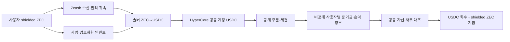

# Zcash 기반 비공개 선물 인텐트 연구

상태: **PROPOSED / 오프라인 모형** · 2026-10-04 KST. 이 문서는 별도 제품 연구의 설계 원본이다. 현행 WHYPE·USDC Vault의 ABI, 채택된 자산 경로 또는 출시 범위를 변경하지 않는다. 연구 상태는 [STATUS](STATUS.ko.md), 작업 조건은 [ZPI 백로그](BACKLOG.ko.md#zpi-001)를 따른다. 로컬 모형은 [private_intents_model.py](../scripts/private_intents_model.py)에 있다.

## 1. 제품 목표와 관찰자

사용자는 shielded ZEC로 시작해 서명한 선물 거래 의도를 제한된 솔버에게 전달하고, 정산 후 shielded ZEC를 받는다. 개인별 포지션·손익은 공개 체인이 아니라 별도 장부에 기록한다. 솔버는 ZEC→USDC 유동성과 Hyperliquid 실행을 담당한다. 현재 목표는 **공개 관찰자에게 개인별 입금·포지션 연결을 어렵게 하는 것**이다. 운영자·솔버로부터도 완전히 숨기는 것은 별도 연구 과제다.

| 관찰자 | 제안 구조에서 보이는 것 | 남는 노출 |
| --- | --- | --- |
| Zcash 공개 관찰자 | shielded 거래의 존재 | shielded pool 경계, 타 체인 이동의 시간·금액 상관관계 |
| Hyperliquid 공개 관찰자 | 공동 계정의 주문·체결·청산·잔액 | 사용자 수가 적거나 주문이 독특하면 개인 전략 추정 가능 |
| 견적 솔버·운영자 | 자신이 처리한 입금·견적·주문·출금 연결 | 초기 버전은 이 주체를 프라이버시 신뢰 대상으로 둠 |
| 사용자 | 자신의 의도·체결·손익·청구권 | 공동 계정 전체 지급 능력의 별도 증거 필요 |

HyperCore의 모든 주문·취소·거래·청산은 [공개](https://hyperliquid.gitbook.io/hyperliquid-docs)다. 공동 계정과 배치 실행은 개인별 귀속의 공개 노출을 낮추는 방식이지 HyperCore 실행 자체를 비공개로 바꾸지 않는다. 첫 배포에 충분한 사용자 수·배치가 없다면 이 프라이버시 효과를 보장하지 않는다.

## 2. 제안 흐름과 각 단계의 증거

1. **권리와 입금:** 별도 일회용 인텐트 키가 `intentId`, nonce, 만료, 시장, 방향, 수량, 가격 제한, 레버리지 상한, 최소 USDC 수령액을 서명한다. 수신 측은 인텐트마다 다른 shielded 수신 주소를 제시하고 viewing key로 해당 note의 금액·귀속을 확인하는 방안을 우선 검토한다. Zcash [통합 viewing key](https://zips.z.cash/zip-0316)의 실제 지갑 지원, 입금 최종성, 환불 권리는 [ZPI-002](BACKLOG.ko.md#zpi-002)에서 검증해야 한다. 지출키를 서버에 보내는 절차는 없다.
2. **견적과 환전:** 솔버는 기한·최소 수령액이 있는 견적을 낸다. ZEC 입금 관측, 솔버의 ZEC 취득, USDC 실제 수령, HyperCore 계정 credit은 서로 다른 사건으로 기록한다. 어느 하나를 다른 사건의 영수증으로 대체하지 않는다. 원자적 Zcash↔HyperCore 결제를 이 초안에서 주장하지 않는다.
3. **주문:** 계정 USDC credit을 확인한 뒤 주문을 제출한다. 제출·체결·취소 최종성을 별개로 기록한다. HTTP 성공이나 시간 경과만으로 미체결 잔량이 사라졌다고 보지 않는다. 부분 체결 후 잔량의 최종 취소 증거가 없으면 출금과 새 위험 주문을 막는다. [현행 Core 액션 복구 원칙](DECISIONS.ko.md#adr-005)과 같은 보수적 경계다.
4. **회계:** 사용자별 증거금, 수량, 평균 진입가, 실현 손익, 거래비, 펀딩비와 지급 대기액을 분리한다. 첫 연구 모형은 한 인텐트당 단일 시장·한 방향·한 번의 진입을 다루고, 반대 방향 사용자 두 명을 같은 공동 계정에 합산한다. 실제 HyperCore 계정의 net 포지션과 사용자별 합계의 완전성은 아직 증명되지 않았다.
5. **정산:** 모든 주문·포지션이 닫힌 단일 epoch에서만 공동 USDC와 개인별 청구권 합계를 대조한다. 부채가 남은 사용자가 있거나 관측치가 다르면 지급을 잠근다. 주문을 내지 않았거나 전량 미체결 취소된 사용자도 Core에 USDC가 도착한 경우 같은 정산 절차로 환급할 수 있다. 각 사용자 지급은 Core→EVM USDC 실제 반환, ZEC 환전, shielded 송금의 독립적인 증거가 필요하다. 로컬 모형에서 이 증거는 `mock_*` 입력일 뿐이다.

Hyperliquid의 기본 선물은 [USDC 담보](https://hyperliquid.gitbook.io/hyperliquid-docs/trading/contract-specifications)를 사용한다. 따라서 ZEC를 Hyperliquid 증거금으로 바로 넣는다고 가정하지 않는다. Zcash 쪽 자산 스왑 [ZIP 228](https://zips.z.cash/zip-0228)은 Draft이며 이 MVP의 의존성이 아니다.

### 실제 adapter가 제공해야 할 증거 계약

아래 필드는 제안 형식이며 현재 구현된 네트워크 API가 아니다. 각 영수증은 원시 응답·체인/계정·고정 시점·검증 방법을 참조해야 한다. 실패·누락은 `0`이나 `confirmed`로 바꾸지 않는다.

| 단계 | 최소 귀속 필드 | 검증해야 할 사실 |
| --- | --- | --- |
| `ZcashDeposit` | chain, txid, note commitment, block height/hash, 인텐트별 수신 주소 식별자, ZEC 금액 원자 단위, scanner 버전 | viewing key로 복호화한 note가 해당 주소에 도착했고 선택한 최종성 조건을 충족함. 지출키와 원시 viewing key는 로그에 넣지 않음 |
| `SolverConversion` | intent ID, 견적 ID/만료, ZEC 인도 영수증, USDC 수령 tx/계정, 실제 순수령·비용 | 견적의 최소 수령액과 실제 인도·수령을 분리해 확인. 솔버의 서명 보고만으로 Core 담보를 만들지 않음 |
| `CoreCredit` | Core 계정, USDC token/DEX, EVM tx와 후속 Core block, 해당 입금 식별자 또는 통제된 단독 인플라이트 기록, 순수령 | 총 잔액 증가만으로 특정 사용자의 입금에 귀속하지 않음. 첫 계정 비용·동시 입금·비요청 송금을 별도 처리 |
| `OrderExecution` | 공동 계정, cloid/oid, 시장, 체결 ID/수량/가격/비용, 취소 최종성, 관측 범위 | 제출, 부분 체결, 무체결·거절, 늦은 체결을 구별. HTTP [`orderStatus`](https://hyperliquid.gitbook.io/hyperliquid-docs/for-developers/api/info-endpoint)는 진단 입력이며 단독 최종성·전체 NAV 증거가 아님 |
| `PoolEquity` | 계정·허용 시장 전부, asset/liability/PnL/funding/fee, 시점·block, raw read 성공/누락 | 같은 시점의 전체 자산과 개인별 채무의 일치. 일부 시장/필드 누락을 0으로 처리하지 않음 |
| `Payout` | Core→EVM 실제 반환, USDC→ZEC 견적/실행, shielded 송금의 tx/note/수령 확인 | 환전·출금 요청만으로 지급 완료 처리하지 않음. 수신자가 확인할 수 있는 지급 증거와 환급 정책 필요 |

Hyperliquid는 주문 상태와 사용자 체결·펀딩 이벤트를 [API/WebSocket](https://hyperliquid.gitbook.io/hyperliquid-docs/for-developers/api/websocket/subscriptions)으로 노출한다. 이것을 receipt 완전성이나 법적 청구권 증명으로 바로 쓰지 않고, Core raw 상태·노드 자료·통제 거래와 대조할 범위를 [ZPI-003](BACKLOG.ko.md#zpi-003)에서 정한다.

### 공동 주문의 부분 체결 배분 모형

[private_intents_batch.py](../scripts/private_intents_batch.py)는 같은 시장·방향으로 묶은 여러 인텐트에 대해 하나의 공개 주문이 부분 체결될 때 **정수 lot 단위**로 사용자별 몫을 단조 증가시키는 오프라인 규칙이다. 사용자별 주문 수량과 가격 한도를 입력하고, 공동 주문 가격이 모든 구성원의 한도 안에 있는지 검사한다. 누적 가중 라운드로빈으로 lot를 나누며 각 fill의 거래비 합계가 원본과 정확히 같게 한다. 구성원·조건을 정렬해 직렬화한 뒤 비공개 salt로 해시한 값은 사후 변경 탐지를 위한 로컬 약속값이다.

오프라인 모형의 `submit_open_batch`와 `mock_batch_open_fill`은 이 배분을 사용자별 증거금·평균 진입가·수수료 장부에 원자적으로 반영한다. 부분 체결 후 공동 주문의 최종 취소도 모든 구성원에게 적용한다. 실제 Hyperliquid 주문 API에는 연결되지 않았다. 외부 시점 기록이 없어 **체결 전에** 약속했다는 증거가 아니고, 사용자가 다른 구성원의 비밀을 보지 않고 자기 배분을 검증할 수 있는 Merkle/ZK 증명도 아니다. 청산 주문의 공동 배치, 반대 방향 포지션의 내부 상계, rebate(음수 거래비), 청산과 자본 부족 시 배분, 큰 주문의 계산 성능, 실제 시장 lot/price tick는 범위 밖이다. 같은 공동 계정이라는 사실만으로 인텐트가 묶이는 것은 아니며, 사용자별 단독 주문은 공개 흔적이 더 선명하다. 이 경계는 [ZPI-003](BACKLOG.ko.md#zpi-003)에서 실제 체결 자료와 대조한다.

## 3. 최소 불변조건과 실패 정책

- 한 Zcash 입금 영수증은 한 인텐트에만 귀속하고, 한 인텐트 nonce·환전 영수증·Core credit·체결 ID·지급 영수증을 중복 소비하지 않는다.
- 실제 Core credit 전 주문을 허용하지 않는다. 전환 중인 ZEC와 USDC를 동시에 사용 가능 담보로 잡지 않는다.
- 체결은 수량과 사용자별 실현 손익에 한 번만 반영한다. 취소 요청은 최종 취소의 증거가 아니다. 늦은 체결 가능성이 있으면 새 주문·출금을 잠근다.
- 폐쇄된 epoch의 `Σ 사용자 USDC 청구권 = 검증된 공동 계정 USDC`를 요구한다. 계정 범위, 미실현 손익, 부채, 펀딩비, 수수료, 인플라이트 이동을 빠뜨리면 등식이 맞아도 생산용 지급 증명이 아니다.
- 개인별 손실이 원금을 넘으면 다른 사용자의 지급을 진행하지 않고 손실 귀속·보전 절차를 먼저 결정한다. 보험/사회화 손실/청산 정책은 아직 미결이다.
- 솔버 지연·부도, Zcash 재편성, 환전 슬리피지, USDC Core credit 지연, 부분 체결, 청산, 환급 불능을 정상 성공으로 바꾸지 않는다. 각 단계의 보류·복구·환불 권리는 별도 설계가 필요하다.

## 4. 로컬 모형의 정확한 범위

`python3 -m unittest discover -s test/python -v`로 두 사용자 손익, Zcash 입금/환전/Core credit 분리, 부분 체결·잔량 최종성, 중복 사용, 가격·최소 수령 제한, 손실·수수료 초과와 지급 잠금, 무거래 환급·epoch 동결, 공동 주문의 정수 lot·거래비 배분과 사용자 장부의 통합을 재현한다. 숫자는 정확한 `Decimal` 문자열로 입력한다. `reconcile_closed_pool`은 **호출자가 제공한 가상 USDC 잔액**과 모형 장부를 비교한다. 실제 HyperCore NAV 검증이나 Zcash proof가 아니다.

연구 코드에 없는 기능: Zcash 지갑·viewing key 스캔, 사용자 서명 검증, 암호화된 인텐트 전송, 견적 경쟁/솔버 담보, 체인 간 최종성 증명, Hyperliquid API·CoreWriter 연동, 계정 상태의 완전성 증명, 임계 서명 custody, 사용자별 ZK 채무 증명, 무허가 회수, 지속 입금·부분 출금, 규제·운영 설계. 통제 testnet 지갑의 별도 생성·동기화 상태는 [STATUS](STATUS.ko.md)를 따른다. 코드가 `mock_*` 영수증을 받는다는 사실은 이 증거를 생산 환경에서 확보했다는 뜻이 아니다.

## 5. 다음 연구 게이트

통제 testnet 지갑을 별도 생성했다. [커뮤니티 faucet](https://fauzec.com/)의 1 TAZ 송금은 지갑에서 Ironwood 수신 note로 관측됐다. CLI가 Orchard 수신 주소로 표기한 값에 송금했지만 지갑 기록은 Ironwood로 분류하므로 주소의 실제 receiver와 송금 pool 선택을 독립 검증한다. Zcash 수신 관측은 [lightwalletd의 compact block 인터페이스](https://github.com/zcash/lightwalletd)와 [librustzcash의 shielded 스캔 기능](https://github.com/zcash/librustzcash)을 후보로 검증하되 이번에 실제 수신된 pool을 포함해야 한다. viewing key를 가진 scanner가 로컬에서 note를 복호화하고 블록 연결·재편성을 추적하는 구성이며, lightwalletd 응답만으로 인텐트 소유권이나 지출 권한이 생기지 않는다. Hyperliquid 쪽은 공식 [testnet API](https://hyperliquid.gitbook.io/hyperliquid-docs/for-developers/api)에서 빈 계정을 읽기 전용으로 조회했다. 체결·담보 관측은 아직 없다. 공식 [testnet faucet](https://hyperliquid.gitbook.io/hyperliquid-docs/onboarding/testnet-faucet)은 같은 주소의 mainnet 입금을 요구하므로 시험 자금 확보를 별도 환경 조건으로 취급한다. faucet 확정과 지갑 수신은 확인됐으나 viewing key만으로 한 독립 관측·인텐트 권리 증거는 없다.

| 게이트 | 검증할 질문 | 실패하면 |
| --- | --- | --- |
| [ZPI-002](BACKLOG.ko.md#zpi-002) 입금 귀속·권리 | shielded 입금·금액·인텐트 소유·환불 권리를 어떤 공개/비공개 증거로 묶는가? | 실자금 수신 금지 |
| [ZPI-003](BACKLOG.ko.md#zpi-003) 주문·잔액 관측 | cloid별 최종 체결/취소와 공동 계정 전체 equity를 독립적으로 대조할 수 있는가? | 실주문·지급 자동화 금지 |
| [ZPI-004](BACKLOG.ko.md#zpi-004) 수탁·지급 | 누가 ZEC 지출권을 갖고, 솔버 실패 시 누가 사용자를 환불할 수 있는가? | 공개 입금 금지 |
| [ZPI-005](BACKLOG.ko.md#zpi-005) 프라이버시 실험 | 배치 크기·시간·금액·운영자 관측으로 개인 포지션을 얼마나 추론할 수 있는가? | 프라이버시 주장 축소 |

현행 Vault는 [USDC 지분을 가진 별도 제품](vault-architecture.ko.md#1-제품-경계와-배포-단위)이다. 여기의 개인별 선물 청구권을 기존 ERC4626 지분으로 자동 표현하거나 현재 USDC Vault에서 바로 실현한다고 가정하지 않는다.
